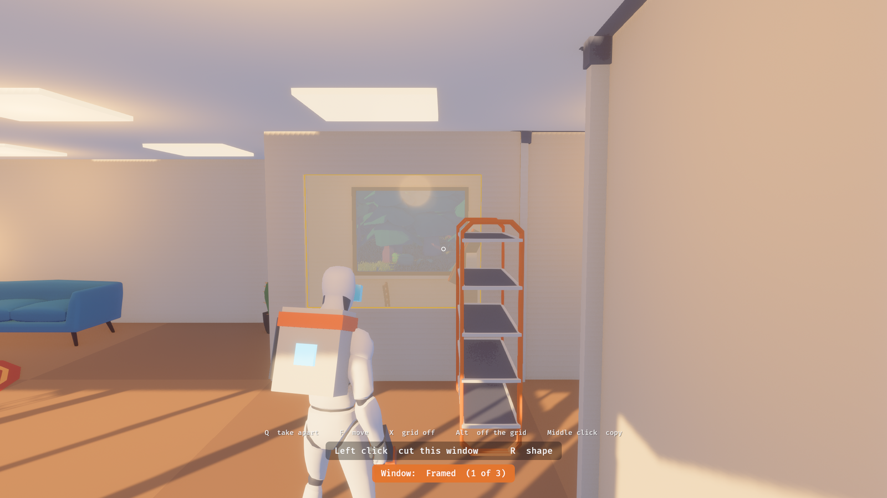

# Game

The game in Bevy (D28, D133): the world on screen, the player, what they carry and build, creatures, people, sound and saving, each a plugin in its own module, and the shell every build runs under (the window, the launch options, scripted runs, the frame-time readout and the remote protocol). Rules every player must agree on stay in the engine-free crates.

It is launched by the [sandbox](../terra_sandbox/README.md) for now, as its `play` and `build` experiments, so the sandbox's options, controls and scripted runs apply there.

The game is three layers of plugins, `WorldPlugin` (from [terra_world](../terra_world/README.md), which this crate stands on and re-exports), `WalkerPlugin` and `GameplayPlugin`, bundled as `play::GamePlugins` ([docs/tech.md](../../docs/tech.md#layers-of-the-game-d198)). A new feature goes in the lowest layer it can, and never needs anything above it to run. The sandbox's `walk` runs the first two alone:

```bash
cargo run -p terra_sandbox -- --experiment walk                                     # the world and a body
cargo run -p terra_sandbox -- --experiment walk --experiment lush --level yard --time 13   # the forest walk
```

## Play

```bash
cargo xtask play
```

`cargo xtask play` runs it on the real GPU wherever you are (under WSL, the Windows build, in a copy of its own) and keeps your game between runs; add `--fresh` to start over, or any of the options above.

The tech demo of the MVP's loop (docs/prototypes.md): a meadow by a lake, a little before sunset, and a player who arrives with a few tools and nothing built. You steer an animated figure in third person. It walks on the planet, climbs the steps to a building's door, is held up by floors, stopped by walls, windows, trees and boulders, and let through doors.


| Input | Action |
|---|---|
| Click | Capture the mouse |
| Esc | The options menu, which gives the mouse back. Esc again returns to the game. |
| Mouse | Look. The arrow keys do the same. |
| Scroll wheel | Bring the camera nearer or take it further, from 1.4 to 9 metres behind you. = and - do the same. While the hammer has a part out that the wheel turns, the wheel turns it instead. |
| W A S D, Shift, Space | Move, sprint, jump |
| 1 to 8 | Pick a slot of the action bar. What is in it is the tool in hand. |
| Tab | Open and close the inventory. I does the same. |
| F | Use what you aim at, within reach: a workbench, smelter, forge or campfire opens its screen, the claim stone grows your claim, a dropped bag gives back what fits |
| H | Eat the most filling food you carry. Clicking food in the backpack eats it too. |
| Left click | With anything but the hammer in hand: swing at a creature in front of you |
| Hold right mouse | With anything but the hammer in hand: guard, taking a quarter of a blow on stamina |
| Ctrl | Roll clear of blows |
| M | The map: the land around the start, only where you have been |
| F5 | Save now. The game also saves every half minute and when it closes. |
| Right mouse | With the hammer in hand: the build menu, a panel of tabs with what you can build and what it costs. Click a tile, or 1 to 7 for a tab, the arrows and Enter. B does the same; Backspace puts the hammer's part away. While carrying an item, it puts the item back. |
| Hold R | The wheel of kinds of what the hammer has: room sizes, window shapes, chair styles. Move the mouse to one and let go. A tap of R steps to the next kind; with Shift, the one before. |
| Hold left click | Build, take apart, or cut. It takes a moment; let go early and nothing is done. E does the same. |
| Left click | In move mode, pick an item up and put it down |
| Scroll wheel | Turn an item, a room or a wall. Z and C do the same. |
| Q | Take-apart mode, and back |
| G | Move mode, and back |
| X | The grid on and off |
| Hold Alt | The opposite of the grid setting, while held |
| Middle click | Pick another of the item you are looking at. V does the same. |
| F3 | More frame timings: per render pass, entities, memory ([development.md](../../docs/development.md#logs-and-the-frame-time-readout)) |

Those are the defaults. In the options menu (Esc) any of them can be set to another key or mouse button, except Esc, the numbers, the wheel and F1 to F3; click a control, then press its new key or button, or right-click it to clear it. The menu also has mouse look speed, invert look, field of view, full screen, vsync, a frame-rate limit (with vsync off; choosing one turns vsync off), graphics quality, and a Sound section: master volume, music, ambience and effects. The list of controls scrolls with the wheel. Every change is saved at once to `settings.txt` in the player's settings folder (`~/Library/Application Support/Terra` on macOS, `%APPDATA%\Terra` on Windows, `~/.config/terra` on Linux). Delete it to go back to the defaults. Scripted runs never read or write it, so a script does the same thing on every machine.

The buttons follow Subnautica 2 where we could confirm what it does: right mouse is the build menu, left mouse builds, and taking apart and moving are modes on Q and G (moving was on F until F became the interact key). The rest is the usual habit of building games. See [research/subnautica-2-building.md](../../research/subnautica-2-building.md).

You carry a backpack, on the rules in `terra_items` and the Subnautica baseline (docs/items.md, D84): a grid in which each item fills its cells and nothing stacks. Beside it is the character sheet (D64): a slot each for a pack, the head, the body and the belt. You start wearing a small pack, which makes the backpack 6 by 5 cells, up from 5 by 4 with none, and carrying a hammer, a stone axe, a stone pickaxe and a knife (D96). Nothing else: everything is taken from the world. The action bar along the bottom points at tools in the backpack; what else you carry is seen by opening the backpack.


- **In hand**: whatever is in the picked slot is in the figure's right hand, as its own look, `models/held/<item>.glb`, made by `tools/characters/fit_held.py` from free models (and a pickaxe built there, since no free one exists): a hammer, an axe, a knife, a spear, a bow, a pickaxe, a torch. Walking or standing, it is carried, an axe's head tipped forward and down; swinging, it is held to strike. A tool you make goes on the bar's first free slot.
- **Worn**: what is in the equipment slots is on the figure: the pack on the back, larger when it is the large pack, the leather coat, the trousers, the boots, the quiver at the right hip. Each item's look is one file for every body, `models/gear/<item>.glb`, carrying the base body's morphs, which says how it goes on; nothing in the code names an item (D127). Every body is the base body shaped by a template (`appearance`, `models/character/templates.json`): the player is male; the villagers are female, heavy, thin and strong.
- **Gathering**: one tool to a job. The axe fells trees for wood, the pickaxe breaks rock for stone and ore rocks (plain grey rock streaked with rust) for ore, the knife cuts bushes and plants for fibre. Aim at one, or just stand in front of it, and hold left click until it gives. A tool's material decides what it can work: the great pines are too tough for a stone axe, and a stone pickaxe is slow on ore. What does not fit in a full backpack drops in a pile at your feet; F at the pile picks up what fits.
- **Claiming**: you build only inside your claim (D94). Anything you aim to build outside one shows red, and the prompt says why. With the hammer, open the build menu, pick Claim stone (two stone), and place it; the claim is 40 metres across, drawn on the ground while the hammer is in hand, and F at the stone grows it to 80 and then 160 for a price (D104). Until you place one, the hammer builds nothing and takes nothing apart.
- **Building** spends materials. Everything has a cost, shown in the prompt before you commit: wood for floors and walls, fibre for windows, hide for a couch. If you are short, the thing shows red and the prompt says what is missing. Taking something apart gives back everything it cost, if there is room in the backpack for it; if not, it stays, and a notice above the bar says why.
- **Crafting** (D109): F at a station opens its screen beside the backpack, the build menu's look with recipes for tiles, each saying what it takes as have/need. Click one, or use the arrows and Enter, to queue one; it is paid for then, and clicking it in the queue takes it off and gives back what it took. Number keys choose a tab where a station has them. Making takes time. The workbench (stone tools, leather gear, a larger pack) and the forge (iron tools, only once a smith lives at your claim) work while you stay near them, and what they make goes into your backpack. The smelter (ore into iron) and a campfire (cooking) work on their own; what they make waits in them until you open them again. Queues are saved. The smelter and forge are shaped from simple pieces until there are models of them.
- **Staying alive**: health, stamina and hunger, as bars at the bottom left. Sprinting, jumping and working spend stamina, which comes back when you stop. Hunger falls all the time; hungry, less comes back; starving drains health until you die (D101). Berry bushes give berries to the knife; meat cooks at a campfire into something far more filling.
- **Storage** (D84, D141): a chest from the build menu's Storage tab holds 8 by 6 cells. F at it opens it beside the backpack; a click moves a thing across, Shift and a click every one of its kind. Building in your claim takes what it needs from your pack first, then from the chests in the claim, nearest first. A chest holding anything is not taken apart or moved.
- **Dying**: you fall, everything in your backpack drops where you fell in a bag, and you wake at a bed in your claim, or where you first arrived. F at the bag takes back what fits; left alone, it is gone after ten minutes (D84). What you wear stays on you, and the action bar still points at your tools when they come back.
- **Skills by doing** (D88): chopping, mining, foraging, building and crafting are learned the first time you do them and improve as you do them more; each step makes that work quicker. The list shows beside the backpack while the inventory is open. Dying costs half the way to each skill's next step, never a step already reached (D101).
- **Creatures** (game design 001, creatures.md): a herd of deer grazes and wanders in the meadow and runs from anyone close or anyone who hurts it; spiders wait in a hollow further off, chase whoever comes near, bite within reach, and go home if led too far. A dead deer can be butchered with F, if you carry a knife, for meat and hide.
- **Fighting** (D97): click to swing at a creature in front of you. The spear, made at the workbench, hits hardest and reaches furthest; tools hit less well. Swings and guards cost stamina; a roll takes you clear of a bite. Landing blows teaches fighting. Where a blow lands matters (D119): a head takes twice what a body does, legs less, and a blow on a creature that has not noticed you, grazing or resting, half as much again. Arrows strike what they pass through first; a swing, what you aim at.
- **Digging** (D39): the ground is voxel terrain. A pickaxe aimed at bare ground digs a scoop out of it when held; what came out is measured, and stone and ore become items by volume, the rest kept toward the next. Soil gives nothing yet. Digs are saved. Under the topsoil is stone, with veins of ore.
- **The bow**: made at the workbench, with arrows four at a time, and a quiver to wear on the belt, a slot of its own on the character sheet (D118). The quiver holds twenty; arrows you make or are given go into it first, and the bow shoots from it first, then from any loose in the backpack. Hold the use key to draw, let go to shoot at whatever the aiming mark is on; a fuller draw flies faster and hits harder, and arrows fall as they go and stick where they land. One good arrow drops a deer, which bolts at nine metres, so you shoot from further off. Hitting teaches archery, its own skill (D117). Butcher what falls with the knife.
- **A place where magic pools** (D103): a hollow further off, lit violet with motes drifting up, seen from a distance. Spiders guard it; while fewer than three remain, another forms there every minute and a half. Nothing marks it on a map (D92).
- **A village** (D95): a few houses, a well and a stall, set down away from the hollow, with people going about their day. Everything in it is built from the same parts as the player's things (D108): each house is its own build, put up by the same operations as a player's rooms, door and windows, and walked into the same way; the well and stall are catalogue items, placed as a player places one, but not yet in the build menu. F talks to them. The elder, Maren, says the spiders took their smith and which way the glow lies, by the sun; the others say what they know.
- **A rescue** (D90): the smith, Bren, kneels bound at the edge of the hollow. With the spiders near them dead, F frees them, and they follow you. Bring them into your claim and they ask for a forge; once one stands there, they settle and work it, and the forge's iron recipes open.
- **Day and night** (D134): a whole day lasts half an hour. The sun rises in the east and sets in the west, the light warm and low at either end; after dark the moon lights the land dimly and the stars come out. Villagers give directions by the sun, or by the moon at night. A new game starts in the morning; the hour is saved.
- **Wear and repair** (D99): tools, weapons and leather wear with use: a tree felled, a scoop dug, a blow landed or taken, an arrow loosed, a part built, a second of a torch burning. A line under the icon shows how much use is left, red when it is broken. A broken thing does nothing but is kept; open the station that makes it, in your claim, and it is mended, free: the workbench for stone tools, leather and the hammer, the forge for iron, a campfire for torches. `play.wear {amount}` over the remote wears what is in hand, for testing.
- **The torch**: you start with one on the bar, and a campfire makes more from a stick of wood and a fibre. In hand it burns, lighting the ground round you, which at night is how you see.
- **The map** (D76): M shows the land around the start, 512 metres across, dark until you have been near it; you are marked on it, and so is your claim. Nothing else is: not the village, not the glow (D92).
- **Saving**: what you built, what you carry and wear, your body and skills, your claim and the people you brought home are saved beside the settings, as `save.ron`, every half minute, on F5 and when the game closes, and loaded when it starts. The land, its plants and creatures come from the world's rules and are not saved, so what was cut or killed grows back (D94). Delete the file, or start with `--fresh`, to begin again.
- **The inventory** shows the character sheet and the backpack's grid. Point at a tool and press 1 to 8 to put it in that slot of the bar. Click a slot of the sheet to take off what is in it, and click gear in the backpack to wear it. The pack will not come off while what you carry would not fit without it. Opening it puts away the part in the hammer's hand.

The materials, costs, recipes and what you start with are stand-ins, chosen so the MVP's loop can be walked.

Building, taking apart and cutting all take time. You hold the button, a bar under the aiming mark fills, and it is done when the bar is full; let go early, or walk off, and nothing is done.

- A room, wall or opening being built has a film that climbs it; one being taken apart has a film that drains away.
- An item being built grows inside its ghost; one being taken apart shrinks.
- A tree being cut shudders, then falls over away from you.

How long each takes follows from the thing: what it costs to build, and how tough it is to cut. A tool can be quicker or slower at cutting each sort of thing, or unable to cut it at all, as `Tool::cuts` in `inventory.rs` says.

Building starts from a part. Pick one from the dial, cycle through its variants, and aim. What would be built is shown before you commit: the outline of a room or wall, the cut of a window, or a ghost of the item where it would stand. It is red where it cannot go.

A base is half-metre cubes (D152, D181): walls are rows of them a storey high, floors and flat roofs layers, doors and windows cubes cut open or glazed; a room is whatever walls close in, worked out as they change. The room part is a shortcut that lays walls round a rectangle, with a floor and a roof inside. Walls are laid in logs, drawn log by log by their kit (docs/building-kits.md); `--walls plain` lays them plain. Rooms and walls are drawn by pressing, dragging and letting go, or clicked to lay at their own size; holding on what is laid builds it.


| Part | Variants | What holding left click does |
|---|---|---|
| Room | Four sizes, in metres; the wheel turns it | Builds walls round the rectangle laid, with a floor and a roof. Laid across a room already there, it extends that room to the combined shape. |
| Wall | Three lengths; the wheel turns it | Builds a stretch of plain wall on the grid line laid, inside or out |
| Window | Four sizes | Cuts a window that wide in the wall you aim at, centred where you aim |
| Door | | Cuts a door in the wall you aim at |
| Remove (Q) | | Takes away the item, closes the window or door, or takes away a stretch of wall that has neither |
| Move (F) | | A click, not a hold: picks an item up, then puts it down |
| Seat, Table, Bed, Storage, Kitchen, Decor, Kit, Fire | Twenty-eight items between them | Stands the item on the floor or ground you aim at |

Everything has a box. An item cannot be placed where its box would share space with another item, a wall, a tree or a boulder, and a walker cannot enter one. Rugs are the exception: they lie under anything. When something is in the way, the prompt says what, and an item that is in the way is outlined.

With the grid on, items land on half-metre steps and turn in eighths of a circle. The grid is drawn on the floor or ground round the item, with tile edges stronger than the steps between. With the grid off, items go exactly where you aim and turn in finer steps. Either way:

- Aim at a wall and the item stands flush against it.
- Aim at the side of another item and it stands flush beside that, lined up with it if nearly so.
- Aim at the top of another item and it stands on it.
- Aim at nothing in reach and it is offered a few steps in front of you.

A room is a plain box: lamps and everything else in it are items you place.

Everything is on one grid of half a metre, set by one constant in `terra_build`. A window or door can be any number of its cells wide and stand anywhere along a wall, and a new room lines up with the rooms already there because they share it. Prices are by measure (floor by area, walls and windows by length), so they do not change if the grid does. A room's foundation may go into the ground, but the room itself may not: where the ground is higher than its floor, the outline is red and it cannot be built.



The game holds the mouse while you play and lets go when the window is no longer in front; click to take it back.

Everything placed in the world, the player's and the village's, goes through the same call the builder makes. The list of parts, with what each costs, is in `catalogue.rs` and is a stand-in.

It is made of these pieces, each a module in `src/play/`:

| Module | What it is |
|---|---|
| `scene` | The sun, the sky's colours, haze, shadows, and the camera's effects |
| `flora` | Trees, rocks, bushes and flowers placed from the seed, and the grass |
| `catalogue` | The parts the builder can build, their variants and what they cost |
| `inventory` | What is carried, on `terra_items`: the backpack, what is worn and the action bar as components on the player, and the demo's kinds of item |
| `bag` | The action bar, the raw-item count, notices, and the character sheet and backpack's grid on screen |
| `interact` | What the interact key would act on: the nearest station, claim stone or person within reach |
| `crafting` | Stations, recipes, and making things from what you carry |
| `claim` | Your claim: placing it, growing it, and drawing its edge |
| `vitals` | Health, stamina and hunger: what wears them down, what brings them back, and the bars |
| `death` | Going down, the dropped bag, and waking at a bed |
| `skills` | Skills by doing: what was done becomes progress, steps make work quicker, dying costs some |
| `creatures` | Deer and spiders: their models and animations, what each does next, and butchering |
| `combat` | Swinging, guarding and the blows creatures land |
| `people` | Figures who are not the player: their bodies and outfits, animations, following, and settling to work |
| `pooling` | The place where magic pools: its glow, its motes, and the monsters that form there |
| `settlement` | The village, its people, and what they say |
| `map` | The map: the land drawn from the planet's rules, revealed as you go |
| `held` | What is in hand, on the figure, by its name |
| `worn` | What is worn, on the figure |
| `save` | Saving and loading the game |
| `harvest` | Gathering with the right tool for each thing, and refusing what its material cannot work |
| `work` | Holding a button until a job is done |
| `tool` | The builder: what it is aimed at, the preview, and building |
| `dial` | The dial of parts and the prompts |
| `props` | Items that have been placed, and stopping a walker at them |
| `figure` | The player's body and which animation it plays |
| `models` | Reading shapes out of model files |

The models are free ones, recoloured in code; see [THIRD_PARTY.md](../../THIRD_PARTY.md). How it was put together and what it costs to draw is in [research/outpost-scene.md](../../research/outpost-scene.md).

What is placeholder: the player and people stand on the two base bodies, with no hair yet (D111, D112), and wear a first set of pieces fitted to them; the ground is voxel terrain that can be dug, but buildings still stand on a foundation clear of it and grass and trees over a hole stay where they were; buildings all look like the old outpost until the art direction is settled; collision is arithmetic (circles round trees and boulders, boxes round items, a grid for walls), not a physics engine, and bushes, small rocks and the figure's own limbs have none; you cannot stand on an item, and an item stood on another stays in the air if the one under it goes; there are no stairs, so upper storeys cannot be reached, and items go on the ground floor only; grass is planted once around the start and runs out about 100 m away; a cut tree never grows back; and none of the work has sound.

**The loop, played live.** `cargo xtask loop` (`tools/sandbox/loop.ts`, `--until STEP` to stop after one) plays the play experiment's loop in one running game on the Windows GPU, driven over the remote protocol: talk to the elder, eat, hunt a deer with the bow and butcher it, dig stone out of the ground and find the hole there after loading, kill the spiders, free the smith and bring them home, place a claim stone, a smelter and a forge, see the smith take up the forge, smelt iron, and have the smith make an iron axe. Each step sets itself up (`warp`, `give`), aims at what it needs by asking the game where it is (`state`, `aim`), acts, and waits for the game to say what happened; the game is restarted once, to load what it saved. A step that fails says what the game said instead and leaves `shots/loop-<step>.png`. It exits non-zero if a step did not happen.

In a scripted run the game clock advances a sixtieth of a second per frame and real keyboard and mouse input is ignored, so the same script does the same thing on any machine:

```bash
cargo run -p terra_sandbox -- --experiment play --settle 480 --press w@20-215 --press b@232-246 --press 8@240 --press e@270-450 --press i@460 --shot shots/a-couch-and-the-backpack.png
cargo run -p terra_sandbox -- --experiment play --vantage -52,14,74,-69,0,52 --shot shots/village.png
```

## Build

```bash
cargo run -p terra_sandbox -- --experiment look --experiment build
```

A base of walls, floors and roofs (D152). It stands on the most level ground near the start, on a foundation, with steps up to its door. Aim with the mark in the middle of the view: V cycles the wall cell you are looking at through solid, three sizes of window and a door, and B adds a room on open ground. The rules live in `terra_build`; the design is [docs/building-tech.md](../../docs/building-tech.md).
