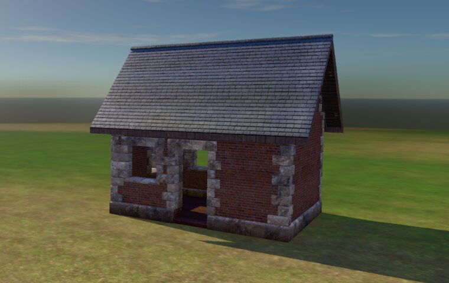

# How building is drawn

How a base of cubes becomes what the GPU draws, end to end, and where each kind of junk on screen (z-fighting, light through a wall, a gap under a roof) can come from and what keeps it out. [building-kits.md](building-kits.md) is how each kind looks, [building-plan.md](building-plan.md#drawing) the numbers for laying, merging and detail by distance, [building-tech.md](building-tech.md) the design. What a piece is made of is moving to hand-made pieces on one material system (D251, D258: a roof's covering its cubes' surface, its edges and a frame's members hand-made modules); the stages below stay.

## From cubes to the screen

| Stage | What happens | Where |
|---|---|---|
| **Cubes** | The truth (D181, D192): each cube its kind, shape, fill and how far built, in sections of 16 a side. Nothing drawn is stored | `terra_build::cubes` |
| **Worked out** | Every face's neighbour and every exposed edge's role (crest, foot, arris, jamb and the rest, D215), the roofs from their cubes' neighbours, rooms. Worked out each time a section is laid, never saved | `layout::roles`, `layout::roofs`, `rooms` |
| **Laid** | Each kit lays its kind's cubes as pieces by its pattern: a timber kind's logs, boards and decks; a block kind's blocks; every kind's dress by role; a roof kind's covering and its parts; gables. The whole base is laid once a change and each section's pieces cut from it, so a piece that crosses sections is laid once (D238) | `layout`, `sections::Whole::lay`, `sections::lay` |
| **Made into meshes** | A block kind's cubes become one surface: faces against a cube of the same wall culled, outside edges rounded by the kit's `bevel`, each face a grid pushed out by its material's height map (D197). A long member is a profile swept along it (D200); dress a profile swept along an edge or corner stones (from `assets/data/kits/pieces`); a roof's covering courses laid on its cubes' slopes | `surface`, `timber`, `dress`, `roofing` |
| **Merged** | A section's pieces in, by kind and material, into one mesh each, their masks (dirt, wear, moss) baked into corner colours. Ghosts are instanced boxes; the next piece is lit | `sections::draw` |
| **On screen** | A base is an entity, each section a child, each mesh a child of that with a `VisibilityRange`: near (25 m), mid (60 m), far (180 m) and proxy (600 m), far and proxy one mesh with the textures baked into colour (as Unreal's HLOD). Each kit's materials are one Bevy `StandardMaterial` per texture set (colour, normal, ARM, height), shared by kits naming the same; a room has a light probe | `terra_game::build::draw`, `build::light` |

A **kit is data** (D136): a file in `assets/data/kits/` says its pattern, sizes, textures, dress by role, masks and how it meets other kinds; its materials are folders in `assets/materials/`. A new wall material is a kit file and a material, and no code: brick (`brick.ron`, Poly Haven's `medieval_red_brick` fetched by `cargo xtask textures fetch`) was added so, dressed in the stone kit's pieces. `cargo xtask kits` checks a kit file; the game reads every one in the folder, and the kit sheet gives each wall kit its rows (`--sheet-rows brick`).

## Where junk comes from, and what keeps it out

A frame shows a fault only from some views; the meshes show all of them. `cargo xtask artifacts` reads every mesh every kit draws, over every roof on every plan in each kind and every two kinds mixed, at every detail, with no GPU (`terra_build::inspect`), and prints how many of each fault and where. `cargo xtask rules` audits the village's buildings for z-fighting too, and that each lays the same twice (D257).

| Fault | What it looks like | Where it comes from | The rule that keeps it out |
|---|---|---|---|
| **Coplanar** | Two surfaces flickering in one plane as the camera moves (z-fighting) | Two pieces, or two kinds, laid flush: a trim on a face, a board on a board, a floor's top on a footing's, two sections both drawing an edge | No two faces in one plane: a piece laid on a face stands proud of it (a deck's boards 8 mm, a frame 3 cm, corner posts and stringers 3 cm); a surface's face against a cube that hides it is culled, not drawn twice |
| **Doubled** | The same, from one triangle drawn twice | Two sections or two passes drawing one piece | A piece is drawn by the section its anchor is in (`Piece::anchor`) |
| **See-through** | Sky or sun through a solid wall or roof | A face culled against something that does not cover it; the surface and a roof or another kind not meeting; a far mesh dropping something the near one had | A face is culled only against a cube that covers it whole: another kind's wall never hides a face, as it is thinner than a cube; a roof cube never does |
| **Under the roof** | A line of sky between a wall's top and the roof | A wall carried up into a roof cube cut short of the roof's underside, or a detail that leaves the gable out | A wall under a roof is carried up and cut at the roof's underside (`Piece::Gable`, `gable_cut`), at every detail |
| **Pokes out** | A piece through a roof's covering, past its edges, or out of a wall | A piece laid by its own rule without the planes round it: a cap over the ridge, a batten past a verge, a lintel bearing too far | Nothing leaves its cubes but eaves, footings and trims up to an eighth of a cube (D192); a roof's parts stay within its covering and edges |
| **Not finite** | A black pixel that spreads under TAA | A normal of no length, as from a degenerate triangle | Every corner, normal and texture place a number |
| **Black** or **inward** | A surface black in sun and shade alike, or lit from behind | Corner colours a mask or bake took to black; triangles wound against their normals, so the inside is drawn | Masks shade, never blacken; every triangle faces its normals. The game warns of a black surface laid with the real maps |
| **Torn change** | For a frame, a piece twice or missing, or a seam, where an edit's sections meet | Sections of one change put on screen in different frames | What a build sends to the workers is swapped in whole, in one frame, the old meshes drawn until then (`draw::upload`) |
| **Strays** | Lit pieces lying about a plan | Each kit's next piece lit at once on the kit sheet | One piece of a base is next, the lowest |

Faults only a frame shows are checked from frames on the GPU: `cargo xtask lodcheck` (now with the village) fails on detail popping and on a frame over 1% black, as when the sky's light was left unfiltered and every shade drew black; `call sandbox.shot {"path", "frames"}` saves every frame of an edit as it happens, to compare.

A fault found once gets a test where it was fixed, so it stays fixed; the checker holds the rest.
