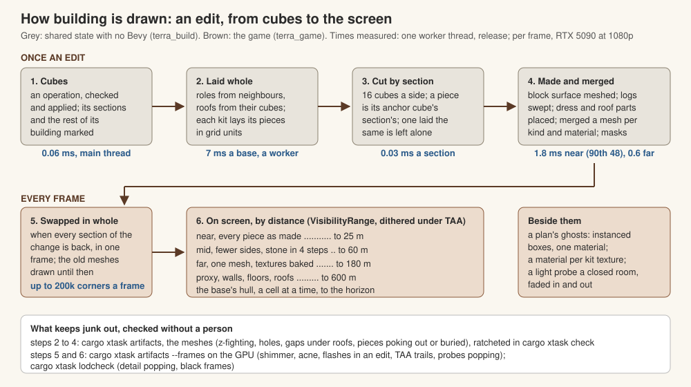

# How building is drawn

How a base of cubes becomes what the GPU draws, end to end, and where each kind of junk on screen (z-fighting, light through a wall, a gap under a roof) can come from and what keeps it out. [building-kits.md](building-kits.md) is how each kind looks, [building-plan.md](building-plan.md#drawing) the numbers for laying, merging and detail by distance, [building-tech.md](building-tech.md) the design. What a piece is made of is moving to hand-made pieces on one material system (D251, D258: a roof's covering its cubes' surface, its edges and a frame's members hand-made modules); the stages below stay.

## From cubes to the screen

| Stage | What happens | Where |
|---|---|---|
| **Cubes** | The truth (D181, D192): each cube its kind, shape, fill and how far built, in sections of 16 a side. Nothing drawn is stored | `terra_build::cubes` |
| **Worked out** | Every face's neighbour and every exposed edge's role (crest, foot, arris, jamb and the rest, D215), the roofs from their cubes' neighbours, rooms. Worked out each time a section is laid, never saved | `layout::roles`, `layout::roofs`, `rooms` |
| **Laid** | Each kit lays its kind's cubes as pieces by its pattern: a timber kind's logs, boards and decks; a block kind's blocks; every kind's dress by role; a roof kind's covering and its parts; gables. The whole base is laid once a change and each section's pieces cut from it, so a piece that crosses sections is laid once (D238) | `layout`, `sections::Whole::lay`, `sections::lay` |
| **Made into meshes** | A block kind's cubes become one surface: faces against a cube of the same wall culled, outside edges rounded by the kit's `bevel`, each face a grid pushed out by its material's height map (D197). A long member is a profile swept along it (D200); dress a profile swept along an edge or corner stones (from `assets/data/kits/pieces`); a roof's covering courses laid on its cubes' slopes | `surface`, `timber`, `dress`, `roofing` |
| **Merged** | A section's pieces in, by kind and material, into surfaces, their masks (dirt, wear, moss) baked into corner colours; then into one mesh a detail, each corner carrying its texture layer (D290). Ghosts are instanced boxes; the next piece is lit | `sections::draw`, `build::draw::parts` |
| **On screen** | A base is an entity, each section a child, each mesh a child of that with a `VisibilityRange`: near (25 m), mid (60 m), far (180 m) and proxy (600 m), far and proxy one mesh with the textures baked into colour (as Unreal's HLOD). Every material's texture sets are layers of four texture arrays (colour, normal, ARM, height, 1,024 texels, BC compressed), drawn by one material (`shaders/build.wesl`), resident while a laid section uses them; a pack's own pieces' atlas is a `StandardMaterial` of its own; a room has a light probe | `terra_game::build::draw`, `build::arrays`, `build::light` |

## What it costs

Measured on 2026-10-14, release builds, the machine shared with other agents' builds (so the slower ends are high).

| Stage | Per edit | Per frame |
|---|---|---|
| An operation checked and applied, main thread | 0.06 ms (research/building-drawing.md) | nothing |
| A base laid whole, a worker | a median 7 ms of the village's fifty (`cargo xtask sections`) | nothing |
| A section cut from it | 0.03 ms | nothing |
| A section made and merged, a worker | near a median 1.8 ms (the slowest tenth over 48 ms: a stone house's whole near section); mid 1.2 ms; far 0.6 ms. An edit's own section again from how it was drawn, 27 ms | nothing |
| Swapped in and uploaded, main thread | every section of a change in one frame, at most 200,000 corners a frame beyond the first section | The game's main thread, with fifty buildings drawn: 13.4 ms a frame against the bare view's 9.4 (`cargo xtask bench village`, at a load of 40 on 32 cores, so the gap is high); a stone house going up a step every tenth of a second, its 8 sections laid and swapped again 288 times |
| Drawn | | The GPU, fifty buildings in view: 3.1 ms a frame against 2.4 bare, 1.8 million triangles in each of the depth prepass and the main pass (RTX 5090, 1080p, high) |

What can go wrong at each stage, and the check that finds it, is the next section.

A **kit is data** (D136, D290): a material file in `assets/data/kits/`, a few lines naming its pattern (`assets/data/kits/patterns/`) and its reference pack (`assets/data/packs/`), its cost and weight, merged over them as it is read ([construction-002.md](proposals/construction-002.md#hundreds-of-materials)); its texture sets are folders in `assets/materials/`. A new wall material is a material file, a pack and its textures, and no code. `cargo xtask kits` checks every material; the game reads every one in the folder, and the kit sheet gives each wall kit its rows (`--sheet-rows stone`).

## Where junk comes from, and what keeps it out

A frame shows a fault only from some views; the meshes show all of them. `cargo xtask artifacts` reads every mesh every kit draws, over every roof on every plan in each kind and every two kinds mixed, at every detail, with no GPU (`terra_build::inspect`), and prints how many of each fault and where. `cargo xtask rules` audits the village's buildings for z-fighting too, and that each lays the same twice (D257).

| Fault | What it looks like | Where it comes from | The rule that keeps it out |
|---|---|---|---|
| **Coplanar** | Two surfaces flickering in one plane as the camera moves (z-fighting) | Two pieces, or two kinds, laid flush: a trim on a face, a board on a board, a floor's top on a footing's, two sections both drawing an edge; a modelled piece folded over itself, or its cut end filled as a fan that folds | No two faces in one plane: a piece laid on a face stands proud of it (a deck's boards 8 mm, a frame 3 cm, corner posts and stringers 3 cm); a surface's face against a cube that hides it is culled, not drawn twice; a wall's face and an opening's head are sunk behind a lintel or sill set into them (`dress::Bed`); a wall with a plinth standing on another kind's footing with its own takes none, and a footing's plinth is kept under its cap; a trim's square end has its part set into the wall cut back; every other course of logs ends a hair short, and the daub under a log stops short of where it is laid to, as courses overlap one on the next. Faces pressed against a face turned to meet them, or let a little into stone, are never seen and not counted. A modelled piece is cleaned as its kit is read (`modules::clean`: faces made double-sided, folds and faces over one another); a module cut to length is closed by ear clipping, once, and not where its cap closes it |
| **Doubled** | The same, from one triangle drawn twice | Two sections or two passes drawing one piece | A piece is drawn by the section its anchor is in (`Piece::anchor`) |
| **See-through** | Sky or sun through a solid wall or roof | A face culled against something that does not cover it; the surface and a roof or another kind not meeting; members narrower than their cubes leaving the rest of the cube open; a far mesh dropping something the near one had | A face is culled only against a cube that covers it whole: another kind's wall never hides a face, as it is thinner than a cube; a roof cube never does. A post up an opening reaches into the courses over and under it; a course an eave comes down too low over is left out and its space blocked with boards to the roof (eave blocking); another kind's wall meeting a timber wall's side has a board up the joint over the cube's margin. Far off a roof's sheet is lifted plumb, as its courses are near, so the facets either side of a hip or ridge meet over it. The checker casts lines through a wall, not along one: up a wall's end only along its core |
| **Under the roof** | A line of sky between a wall's top and the roof | A wall carried up into a roof cube cut short of the roof's underside, or a detail that leaves the gable out | A wall under a roof is carried up and cut at the roof's underside (`Piece::Gable`, `gable_cut`), at every detail; a log carried up under a slope is cut to it from a little over its foot, where the course under it stops, and far off its rings follow the cut. Eave blocking is cut to the roof over it (`Piece::Blocking`, a wedge), split where the roof creases over a hip or valley; under a valley each course stopped short is blocked from where it stops to where the course under it stops in turn, the two blocks meeting; and over a crest under the roof where no course is carried up (a lean-to's high end) the same blocks from its top. Far off the checker counts only a gap open to the outside, as a loft's is seen only from within |
| **Pokes out** | A piece through a roof's covering, past its edges, or out of a wall | A piece laid by its own rule without the planes round it: a cap over the ridge, a batten past a verge, a lintel bearing too far | Nothing leaves its cubes but eaves, footings and trims up to an eighth of a cube (D192); a roof's parts stay within its covering and edges: a hip's or valley's foot at the eaves is mitred to them, not capped square across, a rafter stops inside the edge it runs up to, and an edge's own piece stands past it only as far as it is modelled to (a thatch verge's bundle). Every member carried up under a roof is cut to its slope, a post up a gable's last cube too, and a log's daub stops under its slope cut; a gable's cut follows a corner's hip or valley across its cube. Measured out of each face, so a trim round a corner may stand out of both, and not under the ground, where a plinth is sunk to meet it |
| **Not finite** | A black pixel that spreads under TAA | A normal of no length, as from a degenerate triangle | Every corner, normal and texture place a number |
| **Black** or **inward** | A surface black in sun and shade alike, or lit from behind | Corner colours a mask or bake took to black; triangles wound against their normals, so the inside is drawn | Masks shade, never blacken; every triangle faces its normals. The game warns of a black surface laid with the real maps |
| **Torn change** | For a frame, a piece twice or missing, or a seam, where an edit's sections meet | Sections of one change put on screen in different frames | What a build sends to the workers is swapped in whole, in one frame, the old meshes drawn until then (`draw::upload`); a change older than the newest is shown once it and every older one are back, so a base edited every few frames shows each change whole rather than torn after waiting for a quiet moment. `cargo xtask qa` counts what was shown torn in real time |
| **Strays** | Lit pieces lying about a plan | Each kit's next piece lit at once on the kit sheet | One piece of a base is next, the lowest |
| **Buried** | A piece showing in dashes, or not at all | A piece laid flush with, or inside, a block surface whose relief then stands out over it, as wattle's frame under its daub | A piece over a surface stands proud of its relief |

The checker is a **ratchet** (D287): the faults of each kind in each kit's bases are kept in `crates/terra_build/examples/artifacts-baseline.tsv`, and `cargo xtask check` inspects each kit's and each two kits' rectangle under a gable on every commit (about 20 s) and fails if any count rises; `cargo xtask artifacts --ratchet` holds the whole set (about 4 minutes). As fixes land, `--record` (with `--quick` for the commit check's set) lowers the baseline.

Faults only a frame shows are checked from frames on the GPU, at the high and the low preset, with `cargo xtask artifacts --frames` (D287): scripted runs on the Windows build under WSL, their frames compared pixel by pixel (`tools/sandbox/artifacts.ts`), the worst frame of each check saved with what changed marked red.

| Check | The run | What it finds | Found, 2026-10-14 |
|---|---|---|---|
| **Still** | The village and a street of the town, the clock stopped, forty frames after TAA settles | Any pixel changing: shadow acne flickering under temporal filtering, a cascade not holding still, dither crawling, distant walls' textures shimmering in their mips | Under 0.01% of the picture a frame, high and low |
| **Sun** | The village close to, the clock running, so the sun moves a twentieth of a degree at a time (D204) | Shadow acne and cascades shimmering as the light moves: a true shadow's edge moves by under a pixel | Under 0.02%; none even with the sun's biases taken to nothing |
| **Glide** | The camera sliding slowly down the town's street | A pixel flipping for one frame and back: cascade texels swimming, mips flickering, seams | Under 0.01% |
| **Going up** | A stone house built a step every tenth of a second, from outside and from inside as its roof closes it in | A frame unlike both its neighbours (a section missing or doubled while laid again); a pixel still changing three frames after a piece went in (TAA trailing it); the picture's brightness jumping in one frame (a room's light probe popping) | No flashes or trails. The probe dimmed the room by two fifths in one frame (a 29% jump); it now fades in and out over 0.8 s, under 3% a frame |

Doors and shutters swing (D225) but are not yet among the checks, so TAA trails are checked on pieces going in and on a moving camera. `cargo xtask lodcheck` (with the village and the town) fails on detail popping and on a frame over 1% black, as when the sky's light was left unfiltered and every shade drew black; `call sandbox.shot {"path", "frames"}` saves every frame of an edit as it happens, to compare.

A fault found once gets a test where it was fixed, so it stays fixed; the checker holds the rest.
