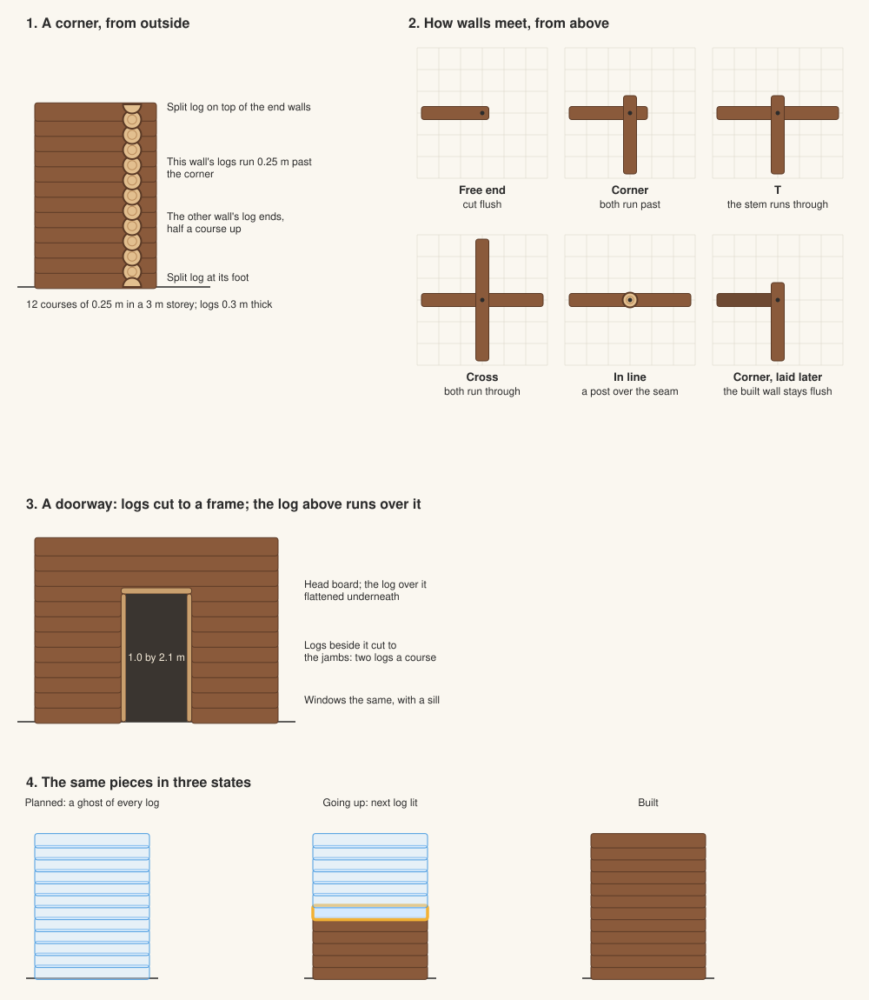
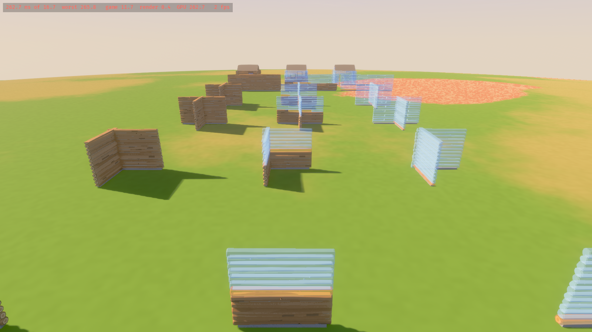
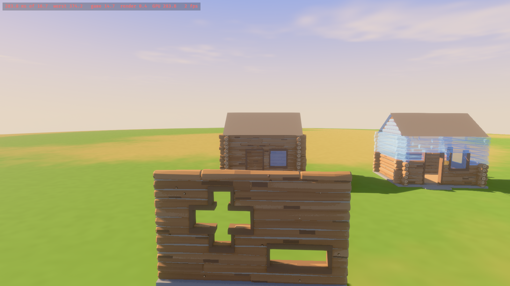
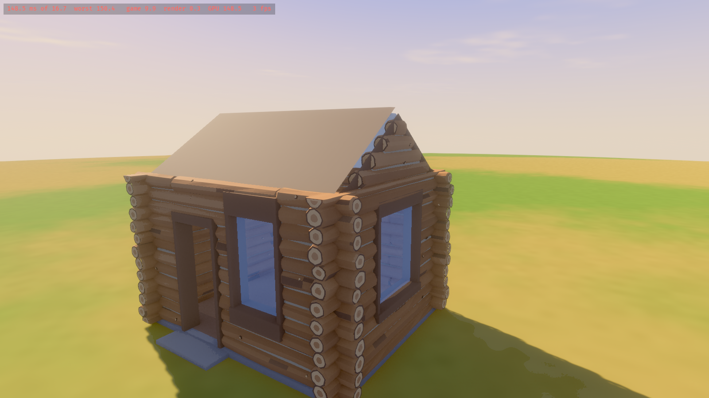

# Building kits: how construction looks, logs first

How each kind of construction looks and is laid, starting with logs. It fills in step 4 of [building-tech.md](building-tech.md#order). How pieces are made and drawn is technical (D177), with block kinds (D197) and timber (D200) drawn from real materials by code; the look of log walls (D178), posts and mixing kinds (D179) are Decided; what a wall costs need not match its pieces one for one.

**The bar is Enshrouded's approach, not its look (D211):** cubes that touch blend into one structure, and each cube's look changes with what it touches and where it sits, as optimised cubes. Every kit here is judged side by side with Enshrouded against that, and changed where it falls short.

**The baseline (D333):** the kits worked on are wood (logs, hewn, shakes) and stone (stone, slate), and where they meet. Earth, lime-washed earth, wattle and daub and thatch, described below, are frozen: they still build and pass their checks, but are not polished, and are out of the settlement, the QA sets and the fault ratchet. No new kit unless the developers ask.



## What a kit has to do

Cubes are laid by hand, or a wall drawn as a line with the quick tools (D226, D154), and the game lays the pieces from the cubes (D146). One layout, worked out by rule from the cubes, serves everything:

- **The blueprint** (D139) is those pieces drawn as a ghost, every log separately, so you can count what is needed, as The Forest's blueprint shows each log.
- **Going up**, each piece is either in, drawn as it will stand, or still a ghost; the next one is lit.
- **Built**, the same pieces, merged into a mesh per section of cubes, kind and material (D213, building-tech.md).
- **While drawing**, the ghost under the cursor is the same layout, laid again each time the line grows by a cube.

So a corner looks the same in the blueprint as it does built, just ghosted. Nothing is modelled twice.

## How pieces are made (D177, D197, D200, D251)

**One system for every kind, of hand-made pieces** (D251). Walls, floors and roofs are all drawn as their cubes' surface in their material, dressed by role with pieces that are to be modelled by hand, as Enshrouded's are; as first built they are made by a script in Blender from numbers, and modelled pieces (Tripo, cleaned up in Blender) replace them role by role (D258). A dressing piece is of the raw materials its kind is built from (D215). Roof coverings are their cubes' surface in the covering's material with modules along their lines, and wattle and daub's frame is modules (D258, [building-plan.md](building-plan.md#one-material-system-d251-d258)); generated logs (below) are still to be compared with a whole modelled log, which a log kit would take by naming a module (`timber.module`).

**Props and trims are models from the art pipeline; code only arranges them** (D177). A kit's look starts as a concept of a whole building drawn to the guide and approved by the developers, [art/props/log-cabin](../art/props/log-cabin/concept.png); each prop is modelled from a concept of its own, drawn the same way, by `tools/props` (Tripo, then a clean-up in Blender to palette roles). The doors and shutters are such props, made again in the style after the first ones were taken out as "ugly ass" (D225): three doors and two shutters in `assets/models/openings`, from `art/props/door-*` and `art/props/shutter-*`, each a kind in `builds.ron`'s `fittings`. They are drawn by `build::props` from where `terra_build::fitting` hangs their leaves, not by a kit, so every kit's openings take them.

**Long members are generated** (D200): logs, beams and planks are a profile swept along each piece the layout gives (`terra_build_mesh::timber`), textured and displaced by real materials from the pipeline, so their shape fits their wall exactly and every one differs. The timber spike compared this with Tripo's log models and with timber as a surface, and the generated logs read most as a log cabin ([research/timber-walls.md](../research/timber-walls.md)). Two profiles from the same code:

| Profile | What it is | Its ends |
|---|---|---|
| Round (the log kit) | A weathered log keeping its bark in patches: tapered from its butt, bowed, its section a little uneven and swelling, scribed flatter top and bottom, a knot or two where branches were trimmed; scanned pine bark in patches over bare wood worn to silvered wood toward its ends and on its weather face (`log_bark` over `log_wood`, D262), each log its own age from brown to grey silver, stained, lichened and mossy at its foot; courses scribed tight with a thin line of daub (D178) | Sawn and chamfered by the axe, showing real scanned end grain with its checks, a picture of four by the end's seed (`log_ends`), stacked at corners a little ragged (a saddle notch) |
| Hewn | A beam squared by the axe: faces gently waved and scalloped by the adze, edges rounded and wandering, a little less tall than a course so daub shows between | Sawn square, flush at corners (a dovetail) |

Each log differs from the next by its seed, from its place, by as much as the kit says: thicker or thinner, more or less tapered and bowed, its section turned, its texture placed anew, a little lighter or darker and warmer or cooler, mottled in long patches along it. Lightly stylised (D14): the variation is a tree's, not a cartoon's. A wall's log is shaded toward the grooves where it meets the logs above and below, most under it, and a little lighter on top where the sun bleaches it, baked into its corners' colour as a modelled log's occlusion is (`groove`); screen-space occlusion is too coarse for a groove a few centimetres deep. A mud daub (Poly Haven's `clay_floor_001`, tinted) fills the groove under each log, between the logs' light and the groove's shade.

**What makes a log read as real** (D262), found by comparing the village's cabins with photographs of real ones: a log's face is pine bark scanned at 4K in patches over bare wood (`log_bark`, `textures.ts blend`, D362; the modelled log's baked bark before it was softer), worn point by point to bare wood weathered silver (`log_wood`, Poly Haven's `rough_wood`, the texture's `worn`), so it has the medium shapes and the light and dark a wall needs at a distance; the bark is lost where a log is exposed, toward its sawn ends, on its top and on its face out of the building it walls (the side not within it, read by column so a window or a hole cut through the wall turns no log; a wall of no building takes a fixed weather way), through the low places of the bark first (`timber.exposed`), so from the street the pale wood follows the courses rather than scattering as camouflage; the texture is a metre round the log by two along it, squeezed into a square and stretched back by the kit, so its grain runs along the log and repeats no more than twice on the longest; its sawn ends are real tree ends (ambientCG's TreeEnd scans, CC0) cut out and drawn round (`textures.ts ends`), opened by checks, darkened and warmed so they sit in the wall rather than standing out as pale discs, an atlas the kit names with `cells`, each end a little lighter or darker than the next and greyed by the weather from hardly at all to most of the way, as ends cut at different times are (D320); and the shade in the grooves. Bark all over (a scan of mature pine at half size) read as brown noise from a few metres and flat from the street, a pale strip of lime daub between every course read as stripes, and one clean end-grain picture turned at every end read as a sticker. A hand-made log laid as the kit's module (D251, D258; `art/kits/logs`, `timber.module`) was compared on the same walls and read worse, its copies seamed each metre and its texture broken where its flat mapping turns, so the logs stay generated and the module is kept, off.

**Block kinds are not pieces** (D197): stone, plaster and earth are drawn as their cubes' own surface, each face a fine grid, rounded along every outside edge and pushed out by its material's height, so a wall of any shape, carved anywhere, is one wall with no seams (`terra_build_mesh::surface`; [research/block-modules.md](../research/block-modules.md)). The stone kit is rough fieldstone, Poly Haven's `stone_wall` (CC0); its file gives the bevel (4 cm) and how far the stone stands out (5 cm). A plan's progress counts its cubes from the bottom up, and the cubes in, the next and the rest are drawn as three surfaces, so the ghost and a wall going up work as for logs. Its edges are dressed by their role (below, D215); an end board stands where logs end against it (D210); doors and shutters are fitted props (D193, D225).

**Every exposed edge is dressed by its role** (D215, [research/role-pieces.md](../research/role-pieces.md)), as Enshrouded's blocks change with what they touch. When a section is laid, each edge of a kind's cubes is given a role from what is round it and the ground's samples (`layout::roles`), never stored; each belongs to one cube, so a piece laid for it is in, planned or carved with that cube, and a part-built wall wears its dress on what is up. The kit's file says what each role takes:

| Role | Where | Stone (`stone.ron`) | Logs (`logs.ron`) | Hewn (`hewn.ron`) | Earth (`earth.ron`) | Wattle and daub (`wattle.ron`) |
|---|---|---|---|---|---|---|
| Crest | Along a top open to the sky | A crowned coping with a drip | A hewn plate as the top course | A heavier hewn plate | A stone coping with a drip | Its frame's plate |
| Foot | Where a wall stands on the ground or another kind, or the ground passes it | A chamfered plinth course, stepping with the ground a course at a time and run on down into it | A hewn sill beam as the first course | A heavier sill | A rubble plinth nearly a cube high, weathered back steeply | Its frame's sill plate |
| Arris | Up an outside corner, or beside a thinner kind | Quoins a course each, long and short by turns | Log ends run past the corner, an eighth of a cube | A squared corner post | (nothing: its corners are round) | A corner post 20 cm square |
| Jamb, Head, Sill | Round an opening | Jamb stones long and short, a lintel bearing 20 cm either side, a sloped sill with horns | Hewn posts up its sides | Hewn posts | Round reveals, one oak lintel set into the earth all but flush, its ends lost in the earth either side, and one oak sill across each opening | Jambs, a head and a sill through the wall, lining it |
| Meet | Where a thinner kind stands on it | A weathered cap under the logs | | | An oak sole plate under a timber kind | |
| Soffit | Under an overhang | A fascia | | | An oak fascia | |
| Nose | Along a step | A tread with a rounded nose | A flight laid as open stairs: treads between stringers, on posts where it stands high | The same, hewn | An oak tread | |
| Border | Along a floor a wall stands on | A border flag | | | A stone border flag | |
| Inside | Up an inside corner | (nothing) | | | (nothing) | Its frame's end posts |

Profiles are drawn in Blender from a source in numbers, `art/kits/<kit>/pieces.json`, into a file the kit names (`tools/kits`). Corner stones are not modelled (D215 as amended): quoins and jamb stones are dressed blocks the game cuts from each block material's own wall, each face the inside of one of its own largest stones, at the sizes the pattern's file gives, so every material's corners match its wall and none wears another's. A profile is swept a cube at a time, mitred out and back round corners, with a chamfered joint where it runs on and its ends closed; each piece stands out up to an eighth of a cube (D192) and casts the shadow line that makes a wall read as built. Masks shade what a kit draws: every face looking down shaded as a modelled piece's baked occlusion would be, so a lintel's soffit or a quoin's underside is not lit brighter than the wall by the ground's bounce (D320); dirt rising unevenly from the ground, worn outside edges, timber greyed higher up; and a roof's covering greened by moss and lichen in blotches toward its eaves, greyed toward its ridge and worn lighter along its eaves and verges (D220). Copings, sills, lintels and plinths are cut from the material's own wall too, unless its pack gives a dressed stone of its own; the block pattern's shared dressed stone, Poly Haven's `rock_boulder_dry` (CC0), is only the fallback for a material with neither; hewn members `rough_wood`. Far off the bands stay and the corner stones drop out. A kit's dress costs about 55 triangles a cube near for stone, 75 for logs, 95 for hewn, 37 for earth and 210 for wattle and daub's frame, averaged over the checker's cabin; `cargo xtask kits` checks every role a kit dresses has its piece, each within an eighth of a cube and of a raw material the kind costs (stone for dressed stone, wood for timber and wattle, a roof's frame and boards too), and their budgets (600 triangles a metre of profile, 320 a corner stone, 800 a metre of module and 600 its cap, its far mesh under half its near one, its faces outward).

**Modules** (D258) are the third sort of piece: a length of mesh along +X, made in Blender by `tools/kits` either from a model kept as source art (`art/kits/<kit>/<piece>/model.glb`, a Tripo model cleaned up, its textures baked into the kit's atlas) or, until one is modelled, by a script from numbers (`art/kits/<kit>/pieces.json`), a section swept along it and shaped as it goes (an adze's scallops, a bundle pinched where it is tied, a ridge's pointed edge), in a few variants; which are which is in [building-plan.md](building-plan.md#one-material-system-d251-d258). A line takes whole copies of it, each stretched to fit, picked by its seed, and is closed by its cap where it stops; it sits on a plane (a member, a bargeboard, a verge's bundle) or is draped over a crease, its two halves on the two slopes (a ridge or hip capping, a valley's roll), so one capping fits a ridge and a hip. A member's module is open along it, so copies run on as one timber, and is scaled across to the member's size. Each is written at a near budget and a far one about a third of it, which far sections draw.

**A kit is a material file** in `assets/data/kits/` (D136, D290), a few lines: its id, its pattern (`block`, `coursed`, `roof` or `frame`, a file in `assets/data/kits/patterns/` holding the pattern's sizes, timber, roles and shared pieces), its reference pack (a file in `assets/data/packs/`: its texture sets, tints, relief, masks and colours, and its own pieces where its outline is its look), its cost, its weight against other kinds and anything it overrides, merged field by field over its pattern and pack as it is read (`terra_build::layers`, a material instance over its parent). A pine cabin, an oak one and a hewn-timber one are three files; nothing about a kind of timber is code. The log kit is `logs.ron`, under shakes; `hewn.ron` is hewn beams under shakes; `stone.ron` is fieldstone under slate. The materials are the developers' set: logs, hewn, stone, earth, lime, wattle and daub, and shakes, slate and thatch; no other is added unless they ask.

## Drawing them

| State | How | Why |
|---|---|---|
| Blueprint | Each piece in a pale, see-through blueprint material, edges brighter so each log reads apart; red where it cannot go. Drawn instanced, many pieces to one draw | Fifty cabins of blueprint are a few thousand pieces, which instancing makes cheap |
| Going up | The pieces in are drawn solid, the rest ghost, the next outlined and pulsing | Says what to bring and where it goes (building.md's prompt) |
| Built | One mesh per section, kind and material, laid again in the background where a change reached | Never an entity per log (building-tech.md) |
| Far off | The plan's boxes in the wood's colour, faded in with `VisibilityRange` | As building-tech.md |

**A real preview, before a click** (asked for on 2026-10-12: "ideally it could be a real preview of whats happening? enshrouded is great at this"). Proposed: whatever the tool would do is applied to a copy of the base and laid again, and the difference drawn where it would be: pieces that would be added as the blueprint ghost, pieces that would be cut or taken away in red, the rest left as they are. A door aimed at a wall shows the logs it would shorten and the frame it would put in; a wall drawn across another shows its corner forming. It is laid again only when what the tool aims at changes, not every frame. This replaces today's outlines and films.

What a walker hits is the cube (D181), not the pieces drawn in it. Log ends sticking out at corners do not block anyone. A blueprint blocks nothing (building.md).

## Logs (D178)

Round logs, saddle-notched at the corners with their ends sticking out: the log cabin everyone pictures, and The Forest's. Squared logs dovetailed flush were the alternative: tidier, with less character.

**Not cylinders.** The art is real materials in detailed textures on clean shapes (D14, art-style.md). A log is made to look grown and cut, not turned: an uneven section, scribed flatter where it sits on the log below; a tree's taper, the butt alternating by seed, a gentle bend and a swelling here and there; bark that stands out from it; sawn ends with a bark ring, lighter sapwood and a darker heart; and a pale strip of daub in the groove between courses, for contrast.

**Courses.** Logs 0.3 m thick (D175), centred in a wall a cube thick and laid 0.25 m apart, so they sit into one another: two courses to a cube, 12 in a 3 m storey, the dozen logs building.md expects. Walls running east to west and walls running north to south are half a course apart, which is how logs interlock at a corner. Walls on one axis start with a split log at the foot and finish with one on top, as real cabins do. Because it goes by axis, every corner, T and cross interlocks the same way, with nothing to work out between walls.

**How walls meet.** A wall is a straight run of log cubes (D181). A cube with runs both ways is a corner, a T or a cross; a run that stops is a free end. Logs run through a corner to its cube's outer face and no further, a few centimetres short here and there, so nothing leaves the grid and anything can be built against them (2026-10-12; they ran 0.25 m past, which got in the way of whatever stood beside them). Each end of a wall is one of these:

| Where | Its logs | |
|---|---|---|
| Free end | Cut flush at the last cube | |
| Corner (L) | Both walls run through the corner cube to its outer face | The ends alternate, a course each |
| T | The through wall runs on; the stem runs into it and ends at its far face | |
| Cross | Both run through | |
| In line, at a post | The two meet end to end under an upright log covering the seam | As building.md's splice |
| Corner, the other wall built first | The built wall keeps its flush ends; the new wall runs through to the corner's face | A butt-and-pass corner, also real |

The last row is what freezing a wall's layout once a piece is in means (building-tech.md). Walls on the two axes never share a course, so a wall laid later never has to move a log already built. A corner drawn in one go, as a room or a loop of walls is, always gets the notched corner.

**Long walls.** Logs are as long as the wall, up to four metres, the longest a tree gives (D174). Longer walls are joined end to end, with the joins staggered from course to course so no seam runs up the wall.

**Openings.** An opening is cubes left empty, of any shape (D181); doors and windows are openings of a default size (D175): a door 1 m by 2 m, a window's sill at 1 m and its head at 2 m. The courses through an opening end at it, cut to a frame of boards along its own edges: jambs up its sides, a head board under the log over it, and a sill under it unless it is at the wall's foot. On the axis whose courses sit half a course up, the hole takes whole logs. An opening in the wall's middle therefore costs logs on both sides of it, as building round a doorway really does.

**Later, with roofs, floors and storeys:**

- **Gable ends**: courses carry on up into the roof cubes over them, each log cut at the roof's slope (D241).
- **A second storey**: starts over a floor a cube thick (D181), so the split logs at the top of one storey and the foot of the next never show together.

Floors and flat roofs of log cubes are drawn as decks (D206).

## Posts anywhere (D179)

Asked on 2026-10-12: "add a pillar to break up walls… arbitrarily? … giving folks some freedom is nice." Agreed: **a post is a column of cubes** (D181), which the kit draws as an upright log or timber; a column with nothing beside it either way is a post. Pick *Post*, click any cube, in a wall or in the open.

- **On a wall**, the wall's logs meet it as they meet the in-line post above: they stop at it, and the wall carries on beyond it. So a long wall broken by posts every few metres is something the player chooses, not something the kit forces.
- **At a corner**, a post takes the place of the notched corner, with flush log ends against it. That gives a second corner look for free: the corner-post cabin, as built in Canada.
- **In the open**, posts hold up a porch roof or a lean-to, or make a fence's ends.
- **Its kind can differ from the wall's**: a squared timber post or a stone pillar in a log wall. That is the next section.

**Posts cut as posts** (D193, D220): the hammer's *Post* lays a column of cubes cut as posts, a storey high to the floor over it, on a footing on the ground. Each kit draws it as its file dresses `Post`: the log kit a round log a little thinner than its wall's, the hewn kit a squared beam, each on a pad of boards where it stands on something, under a deck's bearer where a deck rests on it (below), and under a short bolster across its top where anything else does; the stone kit a pillar 36 cm square of its rubble, a drum a cube, with its plinth round the foot and its coping round the cap. A post holds as a whole cube: a deck or a beam laid on it is joined through it, and nothing of it comes out while they rest on it; a walker meets it as a box 36 cm square, the widest any kit draws, and passes close by it as by a real post.

Placing a post on a wall already built is like a late corner. The built logs stay as they are and the post stands over them, so a post can be added to a finished wall as a detail, without taking the wall down.

This is the first of what the developers called adding "a detail": a part placed on the skeleton that the kits lay themselves round. Beams, trims and corner stones could follow the same way, later.

## Mixing kinds (D179)

Asked on 2026-10-12: "how do you have one wall be log and one be stone". Agreed:

- **Every part has its kind.** A wall, post, floor or roof is laid in the kind picked when it is drawn (Ctrl and the wheel, in building.md's controls). Two walls side by side can be different kinds, and so can the walls and the floor of one room. Each cube keeps its kind, so mixing is per cube.
- **Where kinds meet, the heavier one runs through.** Stone, then logs, then planks, then wattle. At a corner or a T of stone and logs, the stone wall's corner blocks run to its outer face, and the log wall ends flush against it, as a log cabin meets its stone chimney. In line, the log wall butts into the stone wall's end. Stone is thicker (0.5 m against 0.3), so the step between them shows, as it does on real buildings.
- **One wall over another.** Log cubes over stone cubes a metre high are how a cabin gets a stone footing, each laid by its own kit.
- **Changing a kind** is free on a plan nothing is in yet; once it is built, Change material swaps it in place (D232): between two kinds of one pattern, a repaint at once, the old given back and the new taken in one act (D298); across patterns, the old taken out from under what stays and given back, the new built a step at a time.
- **Drawing it** costs nothing extra: a finished building is one mesh per material already.

Built 2026-10-12: a base is laid by every kit in `assets/data/kits/` at once, each its own kind's cubes, so mixing is per cube. Logs end flush against stone, as they end at anything not open air; stone runs through corners and T's. The kit sheet has stone and logs meeting every way walls meet: a stone house under a hip roof, a log cabin on a stone plinth a metre high, an L, a T each way round, in line, stone pillars in a log wall, and a log cabin with a stone end wall.

**How a kit meets the others is its file's** (D232), `meets`: its `weight` (stone 3, timber 2), the heavier running through a joint, its faces and edges dressed there as though the lighter were not (quoins up the joint), the lighter ending against it; its `end` trim where it ends against a heavier kind (`Board`, an end board over sawn ends) and its `carries` trim along its top where a lighter kind stands on it (`Cap`, dressed as its `Meet` role); and `kinds`, by id, what differs for one kind, as `{4: (through: Some(true), end: Some(None))}`. Two as heavy each end against the other. So a new kit says how it meets the rest without code. Changing built cubes' material in place (the hammer's *Change material*) uses the same rules: stone with a block of logs changed into it is quoined round them, capped under them and stands on them without its plinth sinking over them.

## Earth, and wattle and daub (D227, D236)

Frozen by D333: as built, not polished; thatch, lime-washed earth too.

**Earth** (`earth.ron`) is cob or rammed earth: a block kind drawn as its surface like stone, in ambientCG's `Ground104` (CC0, as `packed_earth`), gritty earth with small stones laid down in ridged layers, its grit and ridges pushed out 7 cm by its own height and its finer grit by parallax, its yellow taken down by the kit's `tint` to a grey-brown. It is packed by hand in its shape, not only its texture (the kit's `packed`): lumps 5 cm either way about 60 cm across, and each lift rounded out between the seams where the next was rammed on it, so the wall bulges and its lifts read as ridges from the street, and its outside edges, rounded 12 cm, wander along their length; each lift a little lighter or darker than the next with a darker seam between, wandering along the wall with the ridges (its masks' `strata` and `lift`). It weathers by where it stands (D215), read from its cubes: its foot darkened by the damp splashed up over its plinth (`splash`, measured from its own foot), dark streaks run down under its sills and any top open to the sky but none under eaves (`streaks`), its arrises worn paler (`wear`), and paler from a storey up, dry under the eaves (`dry`). It keeps dry as cob walls do: a rubble plinth at its foot, a stone coping with a drip where its top is open to the sky, under a deep thatch. Its openings have oak lintels and sills, one of each across an opening's full width however ragged its hole, as a builder bridges it with one beam (`dressing`), and where a timber wall stands on it, an oak sole plate: a profile names its `material`, and in timber its texture runs along it as grain. Its corners and reveals are left round, with no quoins. **Lime-washed earth** (`limewash.ron`) is the same cob washed with lime, Poly Haven's `medieval_wall_01`, the earth showing through where the wash has worn: a second kind from the same rules, data only.

**Wattle and daub** (`wattle.ron`) is the first framed kind: a block kind whose cubes are the infill, pale limewashed daub (`patterned_clay_plaster`) with a little relief, and whose file's `framing` lays a frame of squared oak over them by rule (`layout::frames`), each member the kit's module of adzed oak (`member`, `art/kits/wattle`, D258; script-made until its model comes):

| Member | Where |
|---|---|
| Sill plate, plate | Along the foot and the top of each face; a doubled girt where one storey stands on another |
| Posts | Every `bay` cubes along the grid (a metre and a half), none within a metre of a row's end, so short studs stand over and under openings; an end post where a face ends against another kind or in an inside corner |
| Rails | At the kit's heights in each storey (one and two metres), between the posts: under their line in a storey's lower half and over it in its upper, so they run into a window's sill and head |
| Braces | In the lowest and highest panel at each end of a face, leaning in to the end |
| Gables | The wall carried up into its roof (D241), framed as a triangle by the same rule, not as the steps of its cubes: the wall's plate a girt across it, studs over the wall's posts each cut off under the roof, rails at the kit's heights out to the roof, and at each end a brace from the girt up to the outer stud, parallel to the roof over it; nothing along or up its steps |
| Corner posts | A square post up every outside corner |
| Openings | Jambs, a head and a sill through the wall, lining the reveals, round any hole: a doorway's or a cut cross's |

Every member stands 3 cm proud of the daub, so the panels read set back in the frame; where members meet, one ends at the other's side. While a cube is part built, or being carved, its **wattle** shows (`Piece::Wattle`, woven hazel generated and tiled by `tools/textures`, D191): a cube goes in in four steps, its frame and wattle first, then its daub in three coats, and on the kit sheet's going-up column the wattle runs a layer ahead of the daub. A further framed kind, plaster or brick nogging, is a kit file with its own `framing`.

**How they meet the rest** (D232): earth weighs 3, runs through logs, hewn timber and wattle and carries its sole plate under them; stone runs through earth, so earth stands on a stone wall under its cap. Wattle weighs 1: every other kind runs through it, and it ends against them at its own end posts. Framed kinds' floors stand on stone footings, the footing kind being the first block kind that is not framed. The kit sheet has each kit's walls meeting every way, its openings, a carved wall, a house, its shapes, and each with stone and logs (`--sheet-rows earth`, `--sheet-rows limewash`, `--sheet-rows wattle`).

## Stairs, slopes and halves (D193, D220)

A cube can be cut to a shape: a half (its lower half), a stair (two steps, each a quarter of a metre high and deep, rising toward a side) or a slope (a ramp up to a side). The hammer lays a *Stairs* flight, stairs or a ramp a metre or a metre and a half wide, up a storey to the floor above, each column whole cubes under its cut top; or one *Block* of any shape against the face aimed at, joining the plan of its kind beside it. The wheel turns which way it rises. Walked, each shape holds a walker at its top under their feet: a stair's two steps, a slope's ramp, a half's top.

| | Stone | Logs and hewn |
|---|---|---|
| Stair | A stone a tread, rounded and displaced like the wall, a tread with a rounded nose on each | Open stairs: a thick tread on each step, its nose a little out, housed between two board stringers seated on the floor and bearing at their head on the rim of the deck behind the top step, a post under each stringer only where its span is over 1.8 m, nothing under the treads |
| Slope | The stone's surface cut to the ramp, flagstones on it, a coping raking up each open side, its sides showing over any lower cut beside them | Boards up the fall of the ramp, a cleat across them, between stringers on posts, as a stair |
| Half | The stone's surface cut to half height, flagstones on it, a coping round its open top | A low deck: boards on a rim of beams, joists where it is in the air |
| Upper half (D231) | The surface cut up to half height, a fascia under its open sides, a coping round its top | A box of boards: a deck on top, boards under, its open sides clad |
| Stair or slope upside down (D231) | A stone a step; the surface cut up to the ramp, a fascia raking under its open sides | The same box, its underside boarded raking or stepped, a riser under the step |
| Outer and inner corner slopes (D231) | The surface cut to the two ramps, the lower of them for an outer corner (a hip's), the higher for an inner (a valley's), a coping raking up each open side or level along a high one | Boards up each ramp, each cut at the crease, its open sides clad, each course as long as the shape is wide there |

The hammer's *Block* has the upper half and the stair and slope upside down; *Corner slope* the two corners; the wheel turns them. A brush (Alt and the wheel) lays a box of them a metre, two or four across, its top layer cut to the shape (its bottom layer for one upside down), the rest whole, so a box of slopes is a ramp on a block. The kit sheet's "more shapes" rows show each kit's: a mound hipped all round, an L hipped with an inner corner where its arms meet, and a wall with a doorway under a lintel of upper halves, corbelled out on inverted slopes to the north and inverted stairs to the south. Roof kinds are laid on the same shapes (D241).

**Slopes of a wall's kind are not roofs.** A roof is cubes of a roof kind (D241), drawn as a roof from their neighbours; a slope of stone or logs is a ramp of its own material, and under or beside a roof it is a cube like any other.

**A solid mass of timber** (a platform, a slab: whole cubes of a timber kind side by side two by two on a layer) is laid as a framed deck, not as walls crossing: boards on top on joists where it is in the air, a rim of sawn beams stacked a course deep round its open sides, nothing inside it, and its sides below its top as walls. **A wall two or three cubes thick** is laid as skins of logs along its faces, one a cube of its thickness, its courses crossing only at its ends and where it turns or another meets it, so its faces show logs as a wall a cube thick does and never a grid of sawn ends (D263); a pier lays as a crib, its logs crossing at every corner. The kit sheet's *thick walls and piers* row shows them.

## Between a building and the ground, and its floors (D206)

**Footings** are cubes of the floor's kind where it is a block kind, else of the plan's footing kind, stone by default (D194, D206), laid into every plan on the ground as a part of their own and built first: under each wall from the floor's layer, under a floor's edge from the layer below, down to the cube the ground passes through, so they are set into it all round and no gap shows on a slope. They are drawn as the stone's surface, one with any stone wall or floor they meet. A log cabin stands on a course of stone that rises to its floor on level ground and steps down the hill on a slope. The ground outside is never changed.

**Floors** are drawn by their kind. A stone floor is the stone's surface, its top in flagstones (Poly Haven's `grey_stone_path`, CC0), flatter than its walls since it is walked on; a stone wall's top is capped in them too. A timber floor is a deck, made by the timber code: sawn boards two to a cube, as long as a tree gives, their joints staggered; each board drawn from one plank of `weathered_planks`, so no seam runs down a board; where the floor meets a wall standing on a footing, the boards run on to the logs' faces; a rim beam along any side left open, and joists under it where it is in the air.

**A deck on posts** (D306) is framed within its layer as a carpenter frames one, and as Valheim's and Enshrouded's decks read: posts stand under it, each on a footing, and end under a bearer of the kit's heavy timber (its `Crest` member) running along each line of them at the layer's foot; joists sit on the bearers on every line between cubes, the outermost its edges; a rim joist as deep as the joists closes their ends on each open side, a ledger carries them where they run into a wall; and the boards lie across the joists. Posts in a deck's corner cubes stand a quarter of a metre in from its edge, and the deck overhangs its bearers. A post a storey high, as the hammer lays one, reaches into the deck's layer when the deck is laid at its top: that cube is boarded over with the deck, and the post, or a stone pillar, ends under the bearer. Where a flight of stairs meets a deck the deck keeps its rim, and the stringers' heads bear on it; the hammer's flight climbs from the ground onto the deck ahead of it however high. On a slope each post stands on its own footing, its top at the ground under it, so the posts differ in length. What rests on a member is set against the member's real size, read from the kit's data, so no kit needs an offset in code. The kit sheet's `decks` rows show decks on four, six and nine posts, an L, one against a wall, one two storeys up and stairs up every side, in logs, hewn timber and on stone piers; `terra_build/tests/decks.rs` checks each without a picture.

**A floor drawn alone**, with the hammer's *Floor* on any storey, with no walls on it, is finished at its edges: a timber deck with its rim of beams and its joists, a stone floor paved in its flagstones, its edges rounded into the ground.

**Door steps** are cubes (D261): stairs, and a half where one riser is enough, of the footings' kind, from any doorway down to the ground, a quarter of a metre a riser, each on a footing to the ground; none where the threshold is within 20 cm of the ground. The footing kind's kit draws them as it draws any of its cut cubes.

**Doors and shutters** are fitted props (D207, D225), hung in a hole that fits them by `terra_build::fitting`: a door's leaf in the reveal, inside the jambs and head the kit lays (`FRAME_M`, 4.5 cm), turning a quarter turn into the room on the edge by its jamb; a doorway 1.5 m wide or more takes a pair meeting in the middle. Shutters hang on the wall's outside face over a window, a pair over one wider than half a metre, and fold back flat against the wall. The kit's frame is the frame that stays; the model is the leaf alone, stretched to the hole it hangs in, mirrored for the second of a pair. What is drawn is what stops a walker: each leaf's box where it stands, shut or open.
## Roofs (D241)

A roof is cubes of a roof kind: shakes, slate or thatch, each a kit file (`assets/data/kits/shakes.ron`, `slate.ron`, `thatch.ron`, `pattern: Roof`, numbered from 2048), laid by hand like any cube, cut to slopes, outer and inner corners, halves and wholes (D231), with the material picker and brushes (D232, D233), or as a plan by the hammer's *Roof*, "add a roof with this material" (D226): over the space walls close in, or a rectangle drawn, a gable, a hip, a lean-to or flat, in the roof material in hand or the roof the walls' kit names (`roof_kind`: shakes over logs, slate over stone, thatch over hewn timber). Its look comes from each roof cube's place among its neighbours (`terra_build::layout::roofs`, drawn by `roofing`), as a wall's edges are dressed by their roles (D215):

All on the one material system (D251, D258): the covering is the cubes' surface in its material, and every line a module of the kit's pieces (`art/kits/shakes`, `slate`, `thatch`, made by `tools/kits`), each in the kind's own materials (D215):

| Where | What it is drawn as | Thatch | Shakes | Slate |
|---|---|---|---|---|
| A slope's top | The covering: the cubes' surface lifted by its thickness and pushed out by its texture's height, row by row, so each course's butt stands out as a step | Reed (`riet_01`) 26 cm thick | Split shakes 3 cm | Slate (`grey_roof_tiles_02`) 2.5 cm |
| Where two slopes meet at the top | A ridge capping, draped over both slopes, rounded off or closed where it stops; a ridge a cube wide, one capping down its middle | A block ridge of sedge, its lower edge cut in points, two liggers along it | Two boards, one lapping the other | A saddle-backed stone ridge with a roll, in 40 cm stones |
| An outer corner | A hip, the ridge's capping over its flatter angle | The same | The same | The same |
| An inner corner | A swept valley: the covering runs through, a shallow roll of it along the crease | Reed | Shakes | Slate |
| An open level edge | An eave: the covering carried on down by the kit's `eaves`, drawn only, cut plumb through its thickness | Cut clean, its full depth showing | A fascia board | A fascia board |
| An open sloping edge | A verge, carried on level | Rolled into a bound bundle, pinched at its ties | A bargeboard | A bargeboard |
| Against a wall or a higher roof, or round what stands on it or a hole in it (D343) | Flashing: an apron where the roof rises to it, steps up a sloping line, a back gutter where it falls to it, each the pattern's own part (`Flashing`, `Step`, `Gutter`), the covering tucked 15 cm into a wall beside it | A fillet of lime mortar | A weathered board | The same |
| Underneath | Rafters at every cube, a beam under each crease stopping at the walls, battens a course apart, boards | Round poles | Round pine poles | Hewn oak |

Each cube goes up in four steps of its fill, as its kit's cost says: its frame, its battens, its covering, its trims. The covering's rows lie along level lines up the slope, so courses run round a hip and through a valley, each course shifted along so no two rows repeat. A board's tint weathers it lighter than the bare planks, so a roof's edges read against its covering.

**Gables are walls.** A gable is wall cubes of any kind built up under the slope; a wall cube with a roof cube on it is carried up into it, cut at the roof's deck, the plane the covering lies on and the boards under it are drawn on, in one straight line with no gap or step: over a timber wall its courses carry on up, each log's ends cut to the slope over it; over a block kind its surface, sawn square at the cut, so a stone end wall is stone to the ridge; no cap, quoin or plate is dressed along the steps its cubes climb in. "Add a roof" lays a gable's walls with it, in the kind of each wall's top. A block kind's wall top under a roof takes no coping. The roof's frame stops inside the roof, at a gable's inner face: no batten, beam or rafter runs through a gable or out under its verge (D241). The kit sheet's "gable end" rows put every wall kind under every roof kind, each logging a vantage straight on to its gable.

**Any shape.** A roof is whatever its cubes are: a gable, a hip, an L, T or U, a dormer on a slope (laid into a roof already there, the two one roof, the higher of the two at every point, so the dormer meets the slope in valleys), a roof against a taller wall, a storey built over or beside one with its own roof, a wall, a chimney or a stack standing on its slopes, ridges, hips or valleys or rising through it, a hole in it. A roof's cubes are no wall or floor, and a room under them is indoors. The roof is drawn the same whatever stands on it, and what stands on it is carried down to its deck in its own kind ([building-plan.md](building-plan.md#where-roofs-and-walls-meet-d343)).

A ghost's covering is a plain sheet, without its courses, which costs a tenth as much to draw.

## Checking it

The yard (building-tech.md) has a kit sheet: one of each way walls meet, a free end, a corner, a T, a cross, a long wall, posts, a wall carved a cube at a time and a small cabin with a doorway, windows and a gable roof, every shape in each kit (a platform on posts reached by stairs and a ramp, a step of halves, a post alone) and a floor alone, each in a row of three: built, going up and as a blueprint. Each row's vantage is written to the log, so a picture of it is one command (D69, D71): To the east, each roof kind over the walls that take it, shakes over logs, slate over stone and thatch over hewn timber: a gable, a hip, an L, a T and a U, a dormer, two storeys with a roof over a roof, and a lean-to against a taller wall, built, part-built and as a ghost; and logs and stone mixed under every sensible roof over every plan. `--sheet-rows TEXT` lays only the rows whose names hold it, as `--sheet-rows "slate: L"`, since the whole sheet is heavy to lay.

```bash
cargo run -p terra_sandbox -- --experiment play --level yard --kit-sheet --time 16 --vantage 13,9,-6,13,0.5,-26.5 --shot out/corners.png
```

Everything built is laid in logs by default, the player's own building and the village's houses too; `--walls plain` lays it plain. The kit's file is read again when it is saved, so the look can be tuned with the sheet running. Tests in `terra_build` check the layout without a picture: the courses fill the storey, walls either way never share a course, corners interlock and nothing leaves its cubes, free ends are flush, a door cuts the courses it crosses and is framed, long walls stagger their seams, and gables shorten toward the ridge.





## What it costs

What a part costs is set apart from its pieces (2026-10-12): "we dont need 1:1 the raw materials to visually look the same in the blueprint … placing one log could place 2 or something if it made sense". So a wall's logs are counted by its length, about one log from a tree for each four metres of wall in a course, and setting one carried log may put in two short pieces at once. The numbers are a kit's, to tune.

## First build

Built:

1. **The stacked layout** in `terra_build::layout` (`runs`, `trims`, `ground`, `floors`, `blocks`): each wall's logs, from the runs of log cubes and what meets their ends, in the order they go in; openings framed; gable ends in logs that shorten under the roof.
2. **Generated logs** (D200), `terra_build_mesh::timber`, from the kit file for pine, `assets/data/kits/logs.ron`.
3. **In the game**: a build's walls drawn from the kit instead of the plain boxes, those in merged into one mesh, the rest a ghost with the next lit. Until plans come (step 3 of building-tech.md), the kit sheet sets how far each build is in.
4. **The kit sheet** on the yard.



**Not yet:** the late corner, which needs parts with their own history (step 3); saddle notches cut into the logs, rather than logs meeting; floors with kits of their own; seams between stone sections, which still show faintly.

**Doors and windows are not part of a plan** (the developers, 2026-10-12: "when you're building blueprints/etc, they dont have doors attached ... showing a partial ghost with a door does not reflect how the game should work"). A plan and a building going up show the opening and its frame only; the door or shutters are their own, fitted once the walls round the hole are built (D201, D225).

**Logs stop at roofs.** A log that would pass through a roof or its eaves is cut back where the roof begins, as a builder saws the corner ends under a hip; one cut in the middle is left in two.
