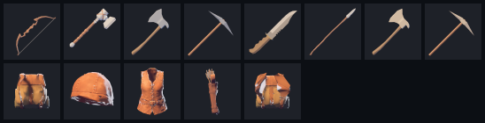
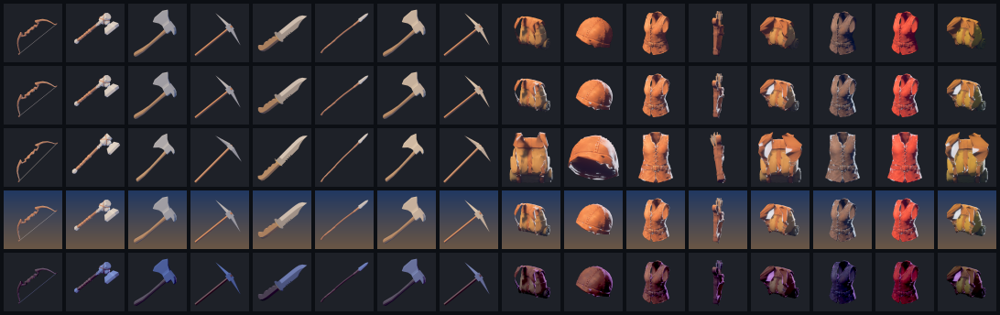

# Items and containers

Status: the developers set Subnautica as the baseline on 2026-10-10 (D84), "for now", and may revisit limits such as weight later. How it works in code is mine to decide (D83). What Subnautica does is in [research/subnautica-inventory.md](../research/subnautica-inventory.md).

## What the developers have said

From 2026-10-10:

- **An equipment grid, a character sheet** (D64): slots for what you wear and carry as gear: head, chest (covering the arms), gloves, legs, feet, back and belt, with more later, such as the parts of a space suit. Not every slot shows on the body. One piece per slot. Jewellery is open.
- **The inventory is the backpack** (D65, Leaning): probably very small at the start, made bigger by a better backpack in the backpack slot.
- **An action bar** (D66): you put items on it to use them; whatever is in the picked slot is in your hand.
- **You carry raw items, and they let you build what you are able to build** (D55, Leaning).
- **Subnautica is the baseline** (D84), and the game must stay modelled in ECS (D58).

## A pack that holds things, after Stationeers

From the developers, 2026-10-11 (D106, Leaning): Stationeers may have some influence, and its backpack model could replace ours, so that wearing a backpack is not growing magical slots: the pack is an item that holds the items in it.

Proposed, what that would mean:

- **A pack is a container you carry.** Its grid is part of the pack. Take it off and the things stay in it; put on another and you carry what is in that one.
- **Death drops your pack** (D84) with everything in it, where you fell.
- **Without a pack** you carry only what is in your hands and on your body: a belt, pockets. Proposed: the action bar is a belt of a few slots that holds tools (D66), with the pack for everything else.
- **Bigger packs** hold more because they are bigger, not because they unlock slots (replacing D65's growth).
- **Technically** (mine): a container's contents belong to the item that is the container, kept by its identity, so moving the pack moves what is in it. `terra_items` would gain nested containers; nothing about a grid changes.

## How it works

Subnautica's rules, with our backpack added:

| | What it is |
|---|---|
| Backpack | A grid. Each item fills a rectangle of cells, most of them one. Nothing stacks. Its size is set by the backpack worn. |
| Equipment | One slot per kind of gear: backpack, suit, helmet, oxygen tank, and so on. A slot takes only gear of its kind. |
| Action bar | A few slots that point at items in the backpack. The item stays in the backpack; if it leaves, the slot empties. |
| Storage | More grids, built in a base. Anyone may use them. |
| Limits | Room in the grid only. No weight. |
| Going down | What you carry drops where you fell, as something you can go back for, until it decays and disappears after a while (D84). Equipment stays on you. |

Picking something up puts it in the first place it fits, scanning from the top left. Items are not turned.

## Items

- **A kind of item is an entry in a list**, as buildables are (D56): its name, its size in cells, and which equipment slot it goes in, if any. Adding an item is adding an entry. A planet's theme names which kinds are found there (D59); planets get no item code of their own.
- **Items wear** (D99): tools, weapons and armour carry their condition, as one-of-a-kind items with state of their own; a broken one stops working but is kept, and is repaired at a station ([crafting.md](proposals/game-design-001/crafting.md#wear-and-repair)). Not built yet in `terra_items`.
- **Every item has an identity**, so the action bar can point at it and the server can say which one moved.
- **Where raw items come from**: harvesting returns a yield in cubic metres, objects or square metres (D45). A table in data turns a yield into items. What the raw items are is design and still open (D43, D55).

## Item pictures

Every slot that holds an item shows a picture of it: the bar, the backpack, the equipment slots, storage and the station screens. Today they show the item's name. Research in [research/item-icons.md](../research/item-icons.md); how to check or fix one in [the item-pictures playbook](../.claude/skills/item-pictures/SKILL.md).

**How they are made** (D129, Leaning, technical): the game draws each picture from the item's own look, in its tint and state, through one fixed camera and light rig, the first time it is shown, and keeps it. Nobody paints a picture, so a new item, colour or variant has one as soon as it has a look (D127), and the picture is always the real thing (D93). A look can say how it sits in a slot, as it says how it is carried; none needs to yet.

**What they look like** (D130, Decided): the game's art style, by drawing the looks in the world's own light.

- **Held things** lie corner to corner, square on, broad side to the front, working end up and to the right.
- **Worn things** face the front, seen from 15 degrees above, as worn, with no body in them.
- **One rig for every picture**: the play scene's warm sun from above and to the left, its blue shade, and a cool light from behind that picks the shape out of the slot. The play camera's grading. No outline and no background: the slot shows through.
- **Framed by the look's bounds**, without perspective, with a little room round it.

The sandbox's `pictures` experiment draws these; nothing in it is set per item. How it was chosen: on 2026-10-12 every look was drawn five ways, a row each: three-quarter from above; the same with the edge light; square on with it; on a plate of the sky's colours; in a darker realm's light. The last three columns are tinted. The developers ruled out the plate and left the rest to me.

What that showed, and still holds:

- **The darker realm's light lost detail** at 64 pixels, so pictures keep one rig whatever realm an item is from.
- **Long, thin things are small in a square**: the bow, the spear, the quiver. Framing each picture to its item's cells, when the game draws them, fixes that.
- **Some items are hard to tell apart**, such as the stone and iron axes. That is their models' colours, to fix in the looks, not the pictures.

## In the game's model

Technical, recorded as D83.

- **The rules live in an engine-free crate, `terra_items`** (D28): kinds, grids, equipment, the bar, and every way an item can move. Tests run with no window.
- **In ECS, a container is a component** on the entity that has it: the player, a locker, a bag dropped where someone went down. The items inside are data in that component, not entities, in the same way health is a number and not an entity. An item lying loose in the world is an entity of its own.
- **Every change is an action the server checks** (D51): move, equip, use, drop, pick up, take from a harvest, spend on a build. The client asks; the server applies it with the same function and says what happened, so the client can show the result at once and is rarely wrong.
- **Nothing is made or lost by moving it.** Only harvesting creates items and only using, building or crafting destroys them. Tests check this over random sequences of moves.
- **Each player is sent only their own containers**, and what others can see of their equipment. Inventories are small: a thousand players with fifty items each is well under ten megabytes on the server (D52).
- **Agents can drive it** (D69, D73): every action is a plain call.

## What is built

The rules, in [`terra_items`](../crates/terra_items/src/lib.rs): the catalogue of kinds, the grid, equipment that resizes the backpack, and the action bar, with a test that random moves never make or lose an item.

The sandbox's `play` experiment carries on it ([README](../crates/terra_sandbox/README.md)): the backpack, the worn pack and the bar are components on the player, building spends from the backpack, taking apart is refused when what it gives back would not fit, and cutting into a full backpack leaves the rest behind. It has a character sheet with a slot each for a pack, a helmet, a suit and an oxygen tank; clicking gear wears it and clicking a slot takes it off. Placeholders: those four slots; a bare backpack of 5 by 4; a starting small pack that makes it 6 by 5; suit parts that do nothing yet; six bar slots; tools two cells wide.

Not covered: crafting, research, what the raw items are, item sizes, and how the inventory looks on screen beyond the stand-in.

## Still open

- **Weight, volume or other limits**: none for now; the developers may revisit (D84).
- Settled for ammunition (D118): **a quiver is a container, holding a stack of arrows, worn on the belt in a slot of its own.** Arrows stack inside a quiver, which is one item. How many it holds, and whether other ammunition works the same way, are open. It fits a pack that holds things (D106).
- **Is what you carry lost for good if you never go back for it?** And does it drop all of it, or only what you gathered since you were last at a base, as in the first Subnautica?
- **How big is the first backpack**, and how many slots does the bar have? Subnautica 2 starts with about 20 cells; the first game's bar has five.
