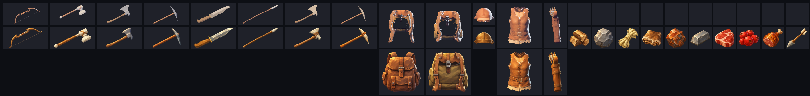
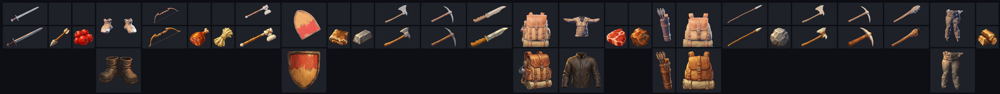

# Items and containers

Status: the developers set Subnautica as the baseline on 2026-10-10 (D84), "for now", and may revisit limits such as weight later. How it works in code is mine to decide (D83). What Subnautica does is in [research/subnautica-inventory.md](../research/subnautica-inventory.md).

## What the developers have said

From 2026-10-10:

- **An equipment grid, a character sheet** (D64): slots for what you wear and carry as gear: head, chest (covering the arms), gloves, legs, feet, back and belt, with more later, such as the parts of a space suit. Not every slot shows on the body. One piece per slot. Jewellery is open.
- **The inventory is the backpack** (D65, Leaning): probably very small at the start, made bigger by a better backpack in the backpack slot.
- **An action bar** (D66): you put items on it to use them; whatever is in the picked slot is in your hand.
- **You carry raw items, and they let you build what you are able to build** (D55, Leaning).
- **Subnautica is the baseline** (D84), and the game must stay modelled in ECS (D58).

## A pack that holds things, after Stationeers

From the developers, 2026-10-11 (D106, Leaning): Stationeers may have some influence, and its backpack model could replace ours, so that wearing a backpack is not growing magical slots: the pack is an item that holds the items in it.

Proposed, what that would mean:

- **A pack is a container you carry.** Its grid is part of the pack. Take it off and the things stay in it; put on another and you carry what is in that one.
- **Death drops your pack** (D84) with everything in it, where you fell.
- **Without a pack** you carry only what is in your hands and on your body: a belt, pockets. Proposed: the action bar is a belt of a few slots that holds tools (D66), with the pack for everything else.
- **Bigger packs** hold more because they are bigger, not because they unlock slots (replacing D65's growth).
- **Technically** (mine): a container's contents belong to the item that is the container, kept by its identity, so moving the pack moves what is in it. `terra_items` would gain nested containers; nothing about a grid changes.

## How it works

Subnautica's rules, with our backpack added:

| | What it is |
|---|---|
| Backpack | A grid. Each item fills a rectangle of cells, most of them one. Nothing stacks. Its size is set by the backpack worn. |
| Equipment | One slot per kind of gear: backpack, suit, helmet, oxygen tank, and so on. A slot takes only gear of its kind. |
| Action bar | A few slots that point at items in the backpack. The item stays in the backpack; if it leaves, the slot empties. |
| Storage | More grids, built in a base. Anyone may use them. |
| Limits | Room in the grid only. No weight. |
| Going down | What you carry drops where you fell, as something you can go back for, until it decays and disappears after a while (D84). Equipment stays on you. |

Picking something up puts it in the first place it fits, scanning from the top left. Items are not turned.

## Items

- **A kind of item is an entry in a list**, as buildables are (D56): its name, its size in cells, and which equipment slot it goes in, if any. Adding an item is adding an entry. A planet's theme names which kinds are found there (D59); planets get no item code of their own.
- **Items wear** (D99): tools, weapons and armour carry their condition, as one-of-a-kind items with state of their own; a broken one stops working but is kept, and is repaired at a station ([crafting.md](proposals/game-design-001/crafting.md#wear-and-repair)). In `terra_items`, an item carries how worn it is and a kind how much it lasts; wearing and mending are changes like any other, so the server can check them.
- **Every item has an identity**, so the action bar can point at it and the server can say which one moved.
- **Where raw items come from**: harvesting returns a yield in cubic metres, objects or square metres (D45). A table in data turns a yield into items. What the raw items are is design and still open (D43, D55).

## Item icons

Every slot that holds an item shows its icon: the bar, the backpack and the equipment slots so far, and storage and the station screens when they show items. Icons are image files in `assets/icons`, loaded by the game; an item with none shows its name. How to make, check and fix them is in [the item-icons playbook](../.claude/skills/item-icons/SKILL.md); research in [research/item-icons.md](../research/item-icons.md).

**How they are made** (D129, technical). As games with many generated items do it: an icon is authored per kind of item, and variation is shown on top of it rather than redrawn.

1. **Rendered**: `cargo xtask icons` renders every item from its own look in one fixed house style, sized to the cells it fills (96 pixels a cell). The render is the fallback icon and the underdrawing.
2. **Painted**: `tools/icons/paint.ts` has the image model repaint the render in the art style, with the mood board's painted workbench and a few approved icons as references, cuts it out and fits it to the item's cells. Items with no look yet, such as materials, are painted from a line describing them in `tools/icons/icons.txt`. A person approves each on a review sheet.
3. **Checked**: `assets/icons/manifest.txt` records the look and style each icon came from, and a test fails when a look has changed since its icon was made. The baker never replaces a painted icon.

Not built: variants shown on top of an icon (a palette shift for a dyed item, a frame or badge for quality or state), until items carry them.

**Which look**: a tool's held look, gear's look on the player's body, and for anything else the item's own look, `models/items/<item>.glb`: the thing on its own as it lies, life size, facing +Z. No item has one of those yet.

**What they look like** (D130, Leaning): painted, in the mood board's style: hand-painted surfaces, chunky readable forms, slightly exaggerated proportions, a bold silhouette, warm light from the upper left, no background. Composed by the render: held things lie along the icon's diagonal, square on, working end up and to the right; everything else faces the front, seen from 15 degrees above, worn things as worn with no body in them.

Every icon on 2026-10-12, renders above and paintings below (materials have no render), at 96 pixels a cell and at 48, a backpack cell's size:

How it was chosen, on 2026-10-12. The developers wanted icons in the art style and left the rest to me. Every look was rendered five ways (three-quarter or square on, with or without an edge light, on a plate of the sky's colours, in a darker realm's light); square on with the edge light read best and the plate was ruled out. Icons were first rendered in play, then baked during development, the usual way. Asked whether rendering is what others do: games with many generated items author an icon per kind, and only render per item where the combinations are the point (Tarkov, Minecraft). Painting four items from their renders read clearly better at slot size than the renders and held one style; the full set followed. What still holds from the comparison:

- **A realm's own light loses detail** at slot size, so renders keep one rig.
- **A painting can drift from its look**: an early stone axe gained a cord binding its model lacks. The reviewer checks each against its render.

## In the game's model

Technical, recorded as D83.

- **The rules live in an engine-free crate, `terra_items`** (D28): kinds, grids, equipment, the bar, and every way an item can move. Tests run with no window.
- **In ECS, a container is a component** on the entity that has it: the player, a locker, a bag dropped where someone went down. The items inside are data in that component, not entities, in the same way health is a number and not an entity. An item lying loose in the world is an entity of its own.
- **Every change is an action the server checks** (D51): move, equip, use, drop, pick up, take from a harvest, spend on a build. The client asks; the server applies it with the same function and says what happened, so the client can show the result at once and is rarely wrong.
- **Nothing is made or lost by moving it.** Only harvesting creates items and only using, building or crafting destroys them. Tests check this over random sequences of moves.
- **Each player is sent only their own containers**, and what others can see of their equipment. Inventories are small: a thousand players with fifty items each is well under ten megabytes on the server (D52).
- **Agents can drive it** (D69, D73): every action is a plain call.

## What is built

The rules, in [`terra_items`](../crates/terra_items/src/lib.rs): the catalogue of kinds, the grid, equipment that resizes the backpack, and the action bar, with a test that random moves never make or lose an item.

The sandbox's `play` experiment carries on it ([README](../crates/terra_sandbox/README.md)): the backpack, the worn pack and the bar are components on the player, building spends from the backpack, taking apart is refused when what it gives back would not fit, and cutting into a full backpack leaves the rest behind. It has a character sheet with a slot each for a pack, a helmet, a suit and an oxygen tank; clicking gear wears it and clicking a slot takes it off. Placeholders: those four slots; a bare backpack of 5 by 4; a starting small pack that makes it 6 by 5; suit parts that do nothing yet; six bar slots; tools two cells wide.

Not covered: crafting, research, what the raw items are, item sizes, and how the inventory looks on screen beyond the stand-in.

## Still open

- **Weight, volume or other limits**: none for now; the developers may revisit (D84).
- Settled for ammunition (D118): **a quiver is a container, holding a stack of arrows, worn on the belt in a slot of its own.** Arrows stack inside a quiver, which is one item. How many it holds, and whether other ammunition works the same way, are open. It fits a pack that holds things (D106).
- **Is what you carry lost for good if you never go back for it?** And does it drop all of it, or only what you gathered since you were last at a base, as in the first Subnautica?
- **How big is the first backpack**, and how many slots does the bar have? Subnautica 2 starts with about 20 cells; the first game's bar has five.
