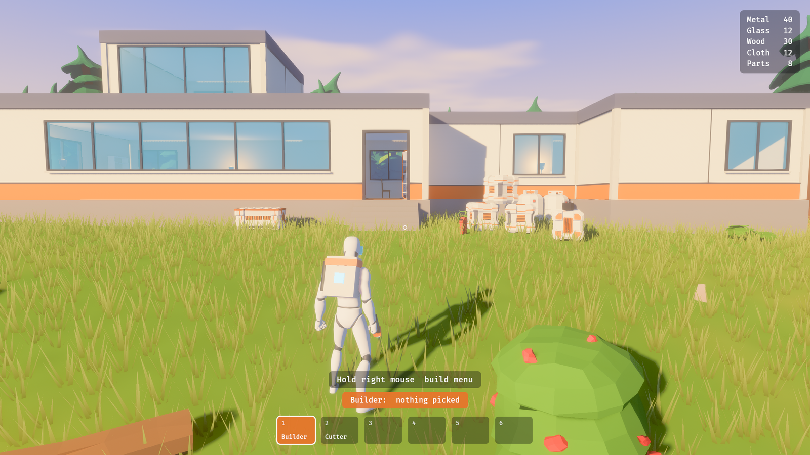

# Player, tools and actions

Status: a draft for the developers to react to. Nothing here is built, and nothing should be until they have. Each section says whether it comes from the developers, is a proposal, or is open.

## The shape of play

From the developers, 2026-10-10 (D50):

> The rough style of gameplay will be like No Man's Sky or Subnautica, broadly speaking: you'll have a player model, you'll walk around with tools to do tasks, collecting resources, being able to take actions like building.

Put plainly: you are a person in the world, not a hand hovering over it. You do things by carrying a tool to where the thing is and using it.

What the two references share, which is the part to take:

- **A body with limits.** You walk, you have reach, you can carry only so much.
- **A small set of tools, each a verb.** What your main button does depends on what you are holding.
- **The world is the source of everything.** You gather by going out and taking it.
- **A base you build and come home to.**
- **Looking is an action.** Both games make scanning things a tool of its own.

Where they differ, and we have to choose:

| | No Man's Sky | Subnautica |
|---|---|---|
| View | First or third person, switchable | First person only |
| Tools | One multitool with modes | Separate handheld tools on a hotbar |
| Inventory | Slots holding large stacks | A grid where items take up shape and space |
| Getting about | Jetpack, ships, vehicles | Swimming, small vehicles, a few large ones |
| Pace | Quick, loose, forgiving | Slower, weightier, more careful |

## The player's body

Proposed.

- **A modelled, animated character**, because other players need to see you in co-op whatever view you play in.
- **Gravity pulls toward the planet's centre** (D63). "Down" changes as you walk around the world, and its strength may differ between planets.
- **Walk, run, jump.** Slopes slow you and steep ones stop you.
- **The ground is whatever is there now.** Movement has to work in holes and tunnels players dug, on a base's floors, and on stairs or ramps between storeys.

Open:

1. **First person, third person, or both?** First person is cheapest: arms and a tool, and the full body is only ever seen by others. Third person shows off the character and the world, suits the art direction's framing, and needs every animation to look good from behind. Both is the most work.
2. **Swimming.** Seas exist once ice melts. Do you swim, wade, or drown?
3. **Climbing.** Can you climb a cliff or a base's wall, or only walk and jump?
4. **A jetpack or similar.** No Man's Sky's jetpack makes rough terrain forgiving. Without one, a player who digs a deep hole needs another way out.
5. **Falling.** Does a long fall hurt?

## Getting off the ground

Open, and the largest unknown here. The world is a real round planet you can leave (D4), so something has to carry you.

6. **How does a player reach orbit?** A ship you board and fly, as in No Man's Sky, is a second control scheme, a second camera, and a vehicle to model. A jetpack that simply keeps going is far less work and far less grand. Nothing needs this until there is somewhere to go, but the player's design should not rule it out.

## Tools

Proposed. A tool is what you hold, and it decides what your main action does. A first set to react to:

| Tool | What it does | Engine piece it uses |
|---|---|---|
| Excavator | Digs and fills ground. What you dig, you collect. | Terrain edits and their yields |
| Harvester | Chops trees, breaks rocks, cuts grass | Removing objects and clearing cover |
| Scanner | Tells you what a thing is; perhaps unlocks things to build | Looking things up by what you point at |
| Builder | Places and reshapes rooms, windows and doors; places machines | Construction |
| Hands | Pick up, open, press | Interaction with objects |

Open:

7. **One multitool or separate tools?** One tool with modes is less to model and animate and fewer things to carry. Separate tools give each action its own feel and make "which tools do I own" a kind of progress.
8. **Is digging the same tool as harvesting?** Rock in the ground and a boulder on it are different things to the engine but may not be to a player.
9. **Do tools run down?** Charge, fuel or wear gives a reason to return to base. It is also a chore.
10. **Do tools improve?** Upgrades are a natural spine for progress.

## Acting on the world

Proposed.

- **Aim with the middle of the view.** Whatever is under it, within reach, is the target: a patch of ground, an object, a wall of a base, a machine.
- **The game says what you are aiming at and what the tool would do**, before you do it.
- **Some actions take time.** Chopping a tree is a few seconds of holding the button, not a click. How long is tuning.
- **Every change to the world is an operation** that returns what it produced. This is how the engine already works, and it is what lets the same action be sent to other players and saved.

Open:

11. **Reach.** Arm's length, a few metres, or long-range beams as in No Man's Sky?

## Equipment, inventory and the action bar

From the developers, 2026-10-10:

- **An equipment grid, a character sheet** (D64): slots for what you wear and carry as gear.
- **An inventory that is your backpack** (D65): probably very small at the start, and made bigger by putting a better backpack in the backpack slot of the equipment grid.
- **An action bar** (D66): you put items on it to use them. Whatever is in the picked slot is in your hand.

What follows from those, proposed:

| | What it holds | How it grows |
|---|---|---|
| Equipment grid | One item per slot: backpack, suit, helmet, tank, and so on | New slots, perhaps, through research (D68) |
| Backpack | Raw items and things you have made | A bigger backpack in the backpack slot |
| Action bar | Tools and things you use, a few slots | Fixed, or grows with gear |

Each is a set of slots holding items, so in the game's model (D58) they are components on the player that hold item entities or item kinds, and the same rules serve all three. The sandbox has a stand-in: raw items as counts, two tools, and a six-slot bar. It has no equipment grid and no backpack.

Still open:

12. **Slots with stacks, or a grid where items take up shape?** "Grid" was said of equipment; it is open for the backpack.
13. **Weight or volume limits** besides the number of slots?
14. **Is anything shared between players**, or does each carry their own, with shared storage only in a base?
15. **What happens to it when you are down** (D18, [survival.md](survival.md))?

## Building as an action

Proposed. Building is something you do with a tool in hand, standing in the world, not a separate mode viewed from above.

- **The build menu comes from the tool** (D67), as in Subnautica: equip the building tool and it brings up a menu of what you can build, which is what you have unlocked (D68, [progression.md](progression.md)).
- With the builder out, you see what you would place or change before committing.
- Building costs what you are carrying. Taking something apart gives some or all of it back.
- The construction system has its own doc: [construction.md](construction.md). The developers have said building should start from choosing a part, with variants to cycle through (D48); the tech demo now does that with a dial.

## Co-op

Proposed, following from what is already recorded (D2, D29). The game is server-first (D51); how many players a world should hold is still open. See [multiplayer.md](multiplayer.md).

- Each player is a body in the same world, with their own tools and what they carry.
- Anyone can dig, harvest and build. A base belongs to everyone.
- The server decides the order of changes; everyone sees the same result.

Open:

16. **Can players get in each other's way?** Blocking a doorway, digging out the ground under someone, taking apart a wall someone else built.

## What this asks of the engine

Technical, for reference. None of it is started except where noted.

- **A character controller on a round world** that walks on voxel ground, dug terrain and base floors. The Godot demo had a working version of the first; the Rust build has none.
- **A rigged character and a way to animate it.** We cannot author one well; the realistic source is a free or bought low-polygon pack with an animation set, pushed through our flat-colour look.
- **A tool and action layer** that turns "what is held, what is aimed at, which button" into an operation.
- **One way to ask what is under the crosshair** across ground, objects, cover, bases and machines. Each has its own lookup today.
- **Smoothing for other players' movement.**

## Not covered here

Terraforming, progression, creatures and combat. The worlds are in [worlds.md](worlds.md) and the survival attributes in [survival.md](survival.md). The developers have said that gameplay is not right away.

## A first walk-around

A playable version exists: the sandbox's `play` experiment, built on 2026-10-10 at the developers' request and then rebuilt the same day as something worth showing. To get started it made choices this doc leaves open, none of which is a decision: third person, so the figure can be seen; one builder tool for everything; and a list of parts chosen by what models were to hand.

What it has:

- An animated figure that jogs, sprints, jumps and turns to face the way it is going, on the stand-in planet.
- Steps and a door into the base, floors that hold the figure up, walls and windows that stop it, and trees and boulders it has to walk round.
- The builder. You pick a part from a dial (room, window, door, a seat, a table and so on), cycle through its variants, and build it where you aim. What would be built is shown before you commit, and a line of text says what each button would do. The buttons follow Subnautica 2 where that could be confirmed.
- Furniture and kit as items you place, turn, move and take away. Each has a box: you walk round it, and nothing can be placed in the same space. An optional grid snaps them into line, and they stand flush against or on top of whatever you aim at.
- Rooms that extend when placed across each other, and interior walls with doorways.
- A place to do it in: a furnished base in a meadow by a lake.

What it does not have beyond stand-ins for carrying, cost and gathering (D55): swimming, stairs between storeys, real collision (D53), or a character of our own. The figure is a recoloured mannequin from a free animation library. How to run it is in the [sandbox README](../crates/terra_sandbox/README.md).

What was proposed, for comparison:

- A character that walks, runs and jumps on the stand-in planet, in whichever view question 1 settles on.
- One tool in hand that harvests the rocks and trees the sandbox already scatters.
- The builder, acting on the existing construction experiment.
- Walking into a base through its door.
