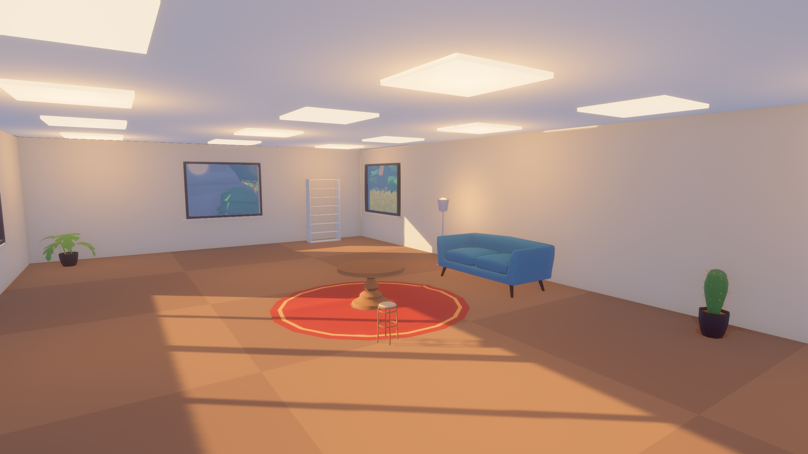

# Art explorations before direction D

2026-10-10 to 2026-10-12, collected on 2026-10-12. Question: what looks did we try or point at before settling on direction D (graphic layers, D14), and what did each teach? This is reference, not guidance: the guide is [docs/art-style.md](../docs/art-style.md). Taken mostly from what [docs/art.md](../docs/art.md) said before D was chosen.

## The order of directions

1. **No Man's Sky** (2026-10-04): the first benchmark. It stays the model for making variety by rule, not for the look.
2. **Forever Ago's flat-coloured facets** (2026-10-10). Simple shapes cut into many small flat planes, flat colour with no texture, warm light against cool shadow, distance turning into haze bands, a small palette per place, small plants in quantity, and a lens with bloom and blur. This became direction A.
3. **Four mood boards** (2026-10-11), each with the same wolf, villager, workbench, tree and outpost: A papercraft facets, B soft rounded shapes, C painted textures, D graphic layers. The page is [Terra Style Directions](https://claude.ai/artifact/AWgMLGJmS5GR7hvjJMbKq4) (private to the developers). The developers' first reaction: D was "pretty dang attractive" and "feels more ambitious"; B was cartoony; A was nice and might sit better with voxels.
4. **The four-world board in C** (2026-10-11): a medieval town, a techno-punk street, fantasy wilds and a gothic graveyard, in C's painted look and rich light. Accepted that day as the target, then replaced by D on 2026-10-12. One of its images is still in `art/style/mood-medieval-town.png`, and the props and characters made before D were drawn after it.
5. **Direction D** (2026-10-12): chosen as the main guideline, to be tried (D14).

## What each taught

- **A** worked with our pipeline as it was, and with smooth voxel terrain lit one triangle at a time. Its risk was facet size: coarse facets read as chunky.
- **C** paints colour into each model, which a game of many realms cannot recolour. It can be split: colour as a palette role per part, with the painted look moved into shared materials and light. Our real renders of the four worlds came out structurally right and far plainer than the concepts. The gap was set dressing, ground cover, density and lighting, not the models ([ai-models-for-art.md](ai-models-for-art.md#the-bake-off-second-round-style)).
- **D can be a shader.** Our own models, rendered with their normals smoothed below 50 degrees, light cut into three crisp bands, the shadow band tinted cool, and haze by distance, read like the D concepts. The same files recoloured by palette role made convincing starter, cold, gothic, ashen and crystal realms. This is why D suits many realms: a realm is a palette and a light. D's concept prompt is in the guide, adapted. The original was: "Stylised 3D render with a graphic, illustrative look: bold simplified shapes, large flat areas of colour from a limited palette, a few crisp shadow shapes, no texture, no outlines; strong silhouettes; warm low sunlight and atmospheric depth."
- **Life size changes how models are made** (D110): a tree designed at 5.5 m and scaled to 20 m keeps car-sized clumps and looks like a toy.

## The Forever Ago screenshots

Linked, not copied: they are someone else's copyrighted images.

| Screenshot | What it shows |
|---|---|
| [Van in the desert](https://shared.akamai.steamstatic.com/store_item_assets/steam/apps/1215940/d3b6a8ba3fa8163acca5cb980fd304c1a7a5cf1e/ss_d3b6a8ba3fa8163acca5cb980fd304c1a7a5cf1e.1920x1080.jpg) | Distance as layers: salmon ground, then lilac and blue mountain bands, then a soft sky. A palette of about five colours. |
| [Forest stream](https://shared.akamai.steamstatic.com/store_item_assets/steam/apps/1215940/aff7bf62c47284177232e7b0a381b3f162ee2b12/ss_aff7bf62c47284177232e7b0a381b3f162ee2b12.1920x1080.jpg) | Faceted rocks beside dense small foliage. Warm light shafts, cool shadow, blur front and back. |
| [House and dog](https://shared.akamai.steamstatic.com/store_item_assets/steam/apps/1215940/f252144f5d2c4d22e08fa7e889961246e8ddbd92/ss_f252144f5d2c4d22e08fa7e889961246e8ddbd92.1920x1080.jpg) | Flat-coloured grass, ferns and flowers in quantity. Low sun and long shadows. |
| [Shop interior](https://shared.akamai.steamstatic.com/store_item_assets/steam/apps/1215940/215e8d117a2fafa80d78a3d3c3996223e68f47df/ss_215e8d117a2fafa80d78a3d3c3996223e68f47df.1920x1080.jpg) | Built things in the same language: flat colour, simple forms, coloured light. |

The developers took its environments and props, not its characters (2026-10-10).

## Other games pointed at

| Game | What to take from it |
|---|---|
| [Firewatch](https://store.steampowered.com/app/383870/) | Landscapes as flat colour layers; a palette that changes with the time of day. The closest of these to D |
| [art of rally](https://store.steampowered.com/app/550320/) | Low-polygon scenery made elegant by restraint and by lens blur |
| [Alba: A Wildlife Adventure](https://store.steampowered.com/app/1337010/) | A soft, friendly low-polygon world full of plants and animals |
| [The Witness](https://store.steampowered.com/app/210970/) | Crisp flat colour with no texture, and strong separation between areas by palette |
| [Road 96](https://store.steampowered.com/app/1466640/) | Stylised people and vehicles in the same simple-shape language |
| [Jusant](https://store.steampowered.com/app/1977170/) | Soft stylised rock and a climb through changing biomes |
| [No Man's Sky](https://store.steampowered.com/app/275850/) | Not the look, but the method: a palette generated per planet, and variety from rules |
| [Enshrouded](https://store.steampowered.com/app/1203620/) | Named by the developers as beautiful (D85): painterly, textured and detailed, nearer C |
| [Sons of the Forest](https://store.steampowered.com/app/1326470/) | Named for its world design (D85): fullness from density and set dressing, which carries to any look. The developers like its realistic style too, "ambitious, we probably can't pull it off" |

## Scenes we rendered

The outpost scene, the game's `play` experiment, made on 2026-10-10 from free packs recoloured to one palette, in direction A's flat facets ([outpost-scene.md](outpost-scene.md)):

The earlier look tests, before any models (`cargo run -p terra_sandbox -- --experiment look --experiment forest`):

What they lacked against every reference: shapes designed by someone rather than lumpy generated ones, foliage beyond one kind of tree, composition, layered distance (the planet was small), water, interiors and people. The outpost fixed some of that. It still lacked other planets, shapes of our own, layered distance, blur and framing, and a character.
