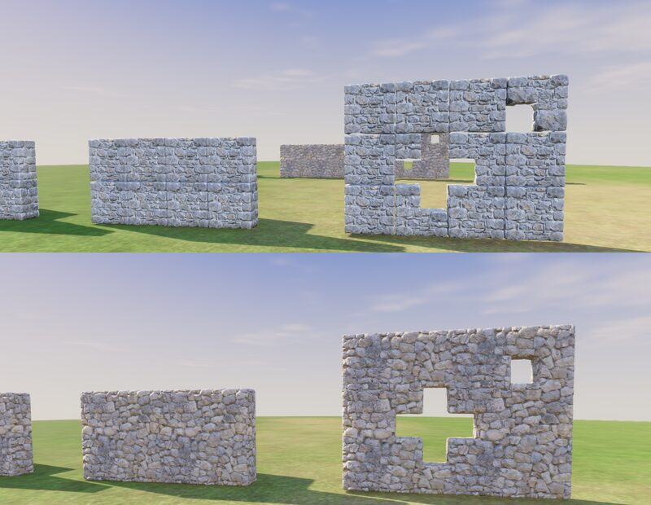
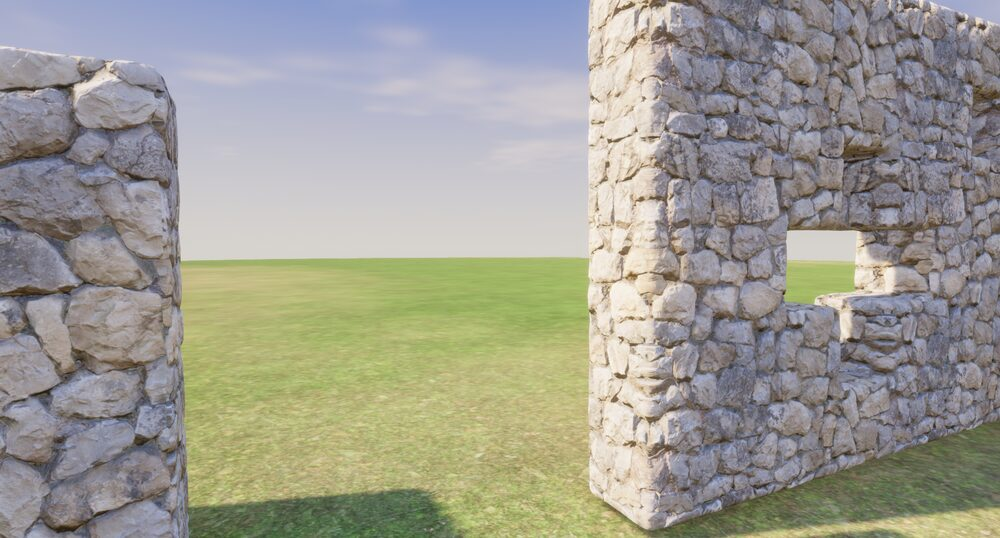

# Block modules: conformed pieces or a displaced surface

2026-10-12. Question (the spike in [spike/block-modules](../spike/block-modules/README.md), step 0 of [building-plan.md](../docs/building-plan.md)): can stone built of pieces chosen by their neighbours, cut from Tripo's stone and conformed at their edges, look as good as whole sections, with no seams? And how does the main other way look: the cubes' surface, bevelled, displaced by a real stone material?

## What was built

The same five shapes of half-metre cubes, both ways: a straight wall, an L, a T, a wall with a cross and a slot carved in it, and a wall part-built. Each was shown in the game's own renderer, on the yard, in the game's light, at the same triangle count (about 1,100 a cube).

- **A, conformed pieces.** The stone kit's three Tripo sections cut into eighth-cube pieces; each eighth of each cube took a piece whose open sides match its own, from the place it would hold if sections tiled the wall, so most neighbours continue each other; where they could not, the seam was pressed into a mortar joint.
- **B, a displaced surface.** The cubes' outer faces, bevelled 4 cm, remeshed at 1.5 cm, displaced 5 cm by Poly Haven's `stone_wall` height map (CC0) projected from each face's plane, textured with its colour and normal maps, and cut back to A's triangles.

## What it showed

- **A reads as a grid of metre blocks.** Every place the sections stop tiling shows: grooves a metre apart both ways, the same stones repeating, and wherever a shape breaks the tiling (a carved hole, a T) pieces from unrelated places meet in visible steps, with gaps where their filled cuts do not line up. Conforming hides a seam's crack, not its pattern. Making it work would take pieces modelled by hand to shared edge profiles, as Townscaper's are, which our pipeline cannot do.
- **B reads as one natural stone wall.** No grid, no seams: the texture runs across every cube, the displacement gives real relief and an uneven silhouette, bevels round every edge, and a carved cross or a T is simply more surface. Close up it holds: stones stand proud, mortar sinks, corners are rounded stone. Its weak points are a stretched band where a face's projection meets a bevel, and its relief being one material's, the same on every wall.

## What it means

For block kinds (stone, brick, plaster, earth), the cubes' own surface, bevelled and displaced by a real material, is far better than modelled pieces: it is the only way that carves, joins and builds any shape with no seams, which is what Enshrouded's building appears to do. Long members (logs, beams, planks) stay modelled pieces; doors, windows, trims and details stay props.

It cuts against D177, which says every piece is a model from the art pipeline. A displaced surface is drawn by code from a material, though the material comes from the pipeline. That is the developers' call.

**To make it real in the game**, B was made in Blender; the game would make the same surface itself, per section of cubes, on worker threads, as the terrain is meshed: the cubes' outer faces, bevelled, subdivided near the camera, displaced by the material's height on the CPU, coarser further off. Further work: blending projections round bevels (triplanar) so no band shows; several materials per kind, varied by place; and a check on the integrated GPU.
