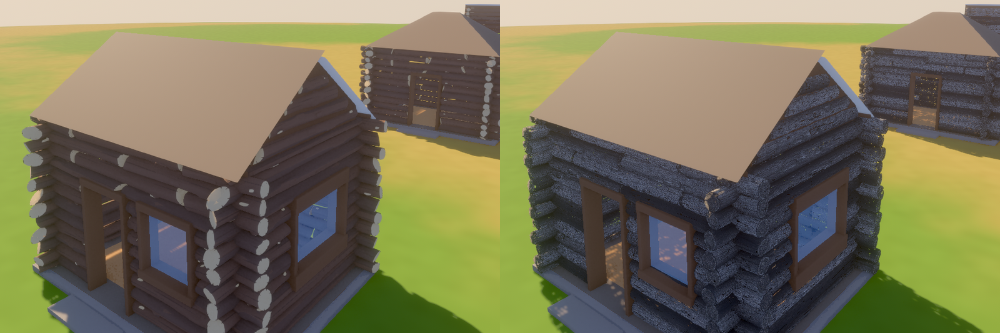

# Realistic textures on building pieces

2026-10-12. Question: do the log cabin kit's pieces look real enough, and less cartoony, when the concept is drawn realistically and Tripo's own textures are kept, rather than drawn flat and painted one palette colour a face as the style guide has it (D14)? Asked by the developers, who want more realism and said it may change the art direction. Tried in `spike/realistic-textures`.

## What was tried

The kit's log, three ways, laid by the log kit's layout into the same cabin on the yard, in the game's light:

1. **Flat roles**: the log concept drawn to the style guide, modelled by Tripo (h3.1), cleaned up by `tools/props` to 1,500 triangles and painted one palette role a face (`Log`, `WoodDark`, `EndGrain`), shaded smooth across curves.
2. **Realistic, at budget**: a concept drawn realistically (weathered wood, grain, checks, hewn flats, growth rings), modelled by Tripo h3.1 with its detailed textures at 4K and its PBR maps kept, cut in Blender to 1,500 triangles.
3. **Realistic, full**: the same at Tripo's 18,500 triangles.

Each copy of the log is stretched along its length to its place in the wall, turned about its length and end for end by its seed (`crates/terra_game/src/build/pieces.rs`).

## Findings

- **Realism comes from the concept and the textures, not the triangles.** The realistic log reads as weathered wood at 1,500 triangles: Tripo gives a normal map, a colour map and an occlusion-roughness-metal map, and the normal map carries the relief after the mesh is cut, as games like The Forest do.
- **The flat log's detail turns into noise.** Painting roles a face puts the pale end-grain colour on hewn flats and knots too; turned about its length, those patches land all over the wall.
- **The textures shimmer.** Fine grain sparkles at a distance: the textures have no mipmaps, which Bevy does not make for glTF images, and no anisotropic filtering.
- **Stretching smears the grain.** A two-metre model stretched over a four-metre course stretches its texture with it.
- **One textured piece among flat ones looks wrong.** The flat roof and boards beside realistic logs read as unfinished.
- **The colour follows the concept.** "Weathered" drew grey; the approved cabin's logs are a deep brown.
- **The full-detail log did not render in time on the CPU renderer**, which is no measure of a GPU but a reminder that triangles are not where realism comes from.

## What a realistic kit would need

What shipped games with built bases do, and what it would take here:

| Need | How it is done | Here |
|---|---|---|
| No shimmer | Mipmapped, GPU-compressed textures (KTX2: BC7 on desktop), anisotropic filtering | A step in the asset pipeline after Tripo; Bevy reads KTX2 with its `ktx2` and `zstd` features |
| No stretching | Several lengths of each piece to choose from, or tileable materials mapped in metres (trim sheets), as modular building kits use | Logs at a few lengths; or a tileable bark and grain material made once, applied to every log |
| One look | Every piece of a kit made from one concept, one colour grade, the same light | The rest of the kit (shakes, boards, ridge, door, window, footing) modelled the same way |
| Variety | Several models per piece, turned and flipped; materials varied by a tint | Three or four logs and footing stones; a tint per piece, by its seed |
| Memory | Shared materials, 2K where it does not show, compression | A budget per kit, measured |
| Many buildings | Normal maps for detail, levels of detail, instancing, merging, stand-ins far off | Instancing comes free in Bevy; the rest is in [building-tech.md](../docs/building-tech.md#drawing-many-buildings) |

## What it means for the art direction

Keeping Tripo's textures is a change to D14, which says no textures and colour by palette role: it gives realism, but colour is baked into each model, so a realm cannot recolour it, and each model risks its own style ([ai-models-for-art.md](ai-models-for-art.md)). A middle way keeps roles for colour and adds shared detail textures (grain, bark, stone) for material. Which way to go is the developers' decision.
