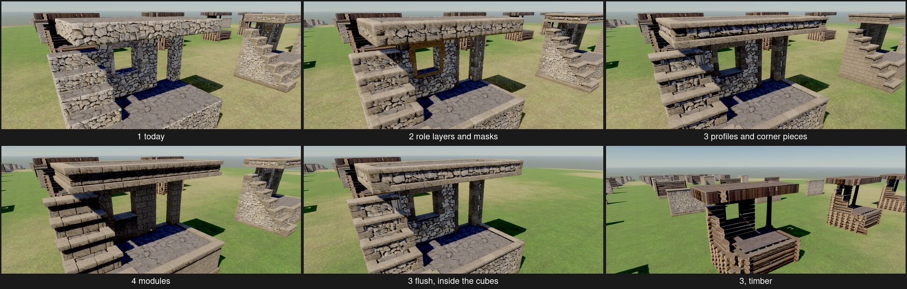
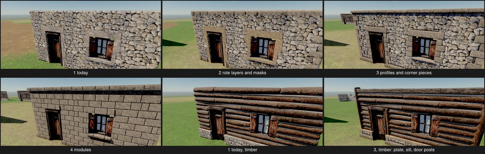
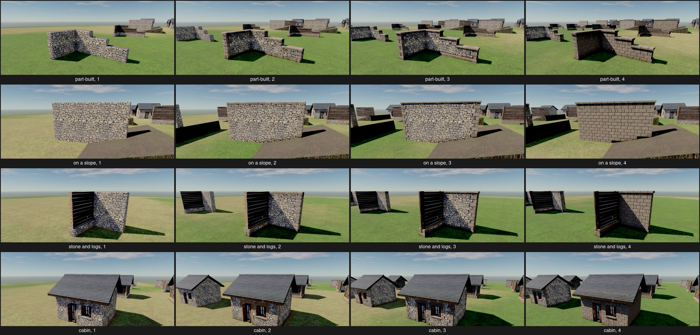

# Role pieces: a look for every exposed part of a cube

2026-10-13. Question (the spike `spike/role-pieces`, step 2a of [building-plan.md](../docs/building-plan.md), following [voxel-building-look.md](voxel-building-look.md)): which way of giving each exposed face, edge and corner of a cube a look chosen by its role and neighbours brings our stone, logs and roofs on par with Enshrouded's blending (D211)?

## What was built

A **role function** (`spike/role-pieces/src/roles.rs`, Bevy-free, in `terra_build`'s style): for every cube of a kind, what is beyond each of its six faces (the same kind, another kind, the ground, the air, or the air in a hole: a cell walled either side and covered over), and from that what each of its twelve edges is: an **arris** up an outside corner, a **jamb** up a hole's side, a **crest** along a top open to the sky, a **sill** along a hole's bottom, a **soffit** under an overhang, a **head** over a hole, a **foot** where a face stands on the ground or on another kind. Edges of one role along a line are gathered into **runs**, each with its two outward normals and how its ends meet the next run (mitred out at an outside corner, back at an inside one, square where it stops). Tests cover a free wall, a carved hole and an overhang. It reads only the cubes and the ground's height, so it can run wherever layouts run.

Four candidates, each drawn on the same cubes by the game's own layouts (`layout::lay_among`, `terra_build::draw`, `surface`, `roofing`), written as models and stood on the yard in the game's renderer and the D212 light (Windows GPU, `--time 14`):

1. **Today**: the D197 surface, D200 timber, D209 roofs, D210 trims, as the game draws them.
2. **Role layers and masks**, no new geometry: the same surface, each point of it asking the roles what it is (`masonry.rs`, a copy of `surface::draw_cut` with that one hook). Quoins up every arris, long and short by course; a plinth course along every foot; a coping band over every crest and across the top; a fascia along every soffit; each in a dressed material, standing a little proud, with joints pressed in. Masks as vertex shades: dirt and damp rising unevenly from the ground, wear along arrises, rain streaks under tops; for timber, dirt at the foot and grey weathering up the wall; for roofs, moss along the eaves.
3. **Profiles and corner pieces**: 2's surface and masks, with the role zones sunk back, and over them pieces by role. Five **profiles** drawn in Blender as polylines with Blender's vertex bevel rounding their corners (`blender/pieces.py`): a crowned coping with a drip, a chamfered plinth, a sloped sill with a drip, a lintel, a fascia. Each is swept along its runs in stones half a cube long with chamfered joints, mitred at corners, capped where it stops; a lintel runs 20 cm into the wall either side, a sill's horns 6 cm. **Corner stones** modelled in Blender to fit them: quoins in three variants, laid long and short by course between plinth and coping; jamb stones up every hole. For timber, the same generator as its logs (D200) by role: a hewn plate along every crest, a hewn sill on whatever the wall stands on, a post up every free end and doorway, and log ends run on past the corners. Built standing out an eighth of a cube (D192 as amended), and once flush, inside the cubes with the rubble set back 3 cm, for reference.
4. **Modules per role**: every exposed side face of a stone cube a module modelled in Blender: coursed dressed stone in a half bond, its stones running on across the modules' edges, chosen from 208 by what its four edges are (a coping or sill over it; a plinth, lintel or fascia under it; an outside or inside corner either side), its bands modelled to 3's profiles and mitred at corners. Tops and undersides stay the surface. Not built for timber, whose logs are already generated along runs (D200); it draws timber as 3 does.

Dressed stone in 2 to 4 is Poly Haven's CC0 `worn_rock_natural_01` (added to `assets/materials`), greyed towards the rubble; today's D210 trims keep `rock_boulder_dry`.

The cases: Keen's gallery test piece (a platform two cubes high with its deck, a flight of seven steps, a wall with a window hole, a post, an overhanging slab) in stone and in logs; a straight wall, an L, a T, a wall with a door and a window, a part-built wall, a wall on a slope, stone meeting logs in an L and a T, and a cabin under its roof, in stone and in logs.

Each was judged beside the Enshrouded gallery image of the nearest material (regular, weathered and castle stone, rough wood) and store screenshots; those are Keen's and are not committed.

## What it showed

- **1 reads as cubes of rubble.** One seamless wall, but every edge the same rounded rubble: no corner, top or foot reads as made. Beside Enshrouded's gallery it is the stack of boxes D211 rules out.
- **2 gets about a third of the way.** From afar the quoins, coping and plinth show as lighter bands and the dirt grounds the wall; close up they are soft. A 5 cm surface grid cannot draw a crisp joint or a stone's edge, so dressed stone looks smeared onto the rubble rather than set in it, and nothing stands out of the silhouette. Its masks are worth keeping in every candidate: the dirt at the foot is the cheapest way to sit a wall on the ground.
- **3 reaches the bar for stone.** The same rubble surface now has dressed quoins at every corner, jambs, lintels and sills round every opening, a coping that caps every top and a plinth along every foot, mitred round corners and steps. Keen's piece reads as Enshrouded's does: each step a slab with its own edge, the platform with a kerb, the slab with a coping over and a fascia under, the post quoined. Carving, part-built and kinds meeting all just work, because everything comes from the cubes there are: a part-built wall wears its coping on each step until the next course goes on. Close up the pieces hold: pitched faces, real bevels, shadow lines. Timber gains less: the plate, the sill beam and door posts make a cabin read as framed, but the log kit's identity was already in its runs; Enshrouded's rough wood (posts at every edge, lashed rails) is a different kit that the same roles would lay.
- **4 is the most finished, and the most like Enshrouded's refined stone.** Coursed ashlar whose bond runs on across modules, so no module grid shows; bands and corners meet exactly because they share 3's profiles. It is a different finish from 3's rubble (refined against rough, as Enshrouded's are separate kits), at two to three times the triangles, and it needs a module set per kit (208 here, generated by one script) where 3 needs five profiles and a handful of stones.
- **The overhang matters.** Flush, the pieces read through material and chamfers only, and the eye takes the plinth and coping for painted bands; standing out up to an eighth of a cube they cast the shadow lines that make Enshrouded's walls read as built. The developers' amendment to D192 is borne out.
- **What the roles found was right everywhere**: L, T, cross, holes carved anywhere (Keen's opening between wall and post is framed like a window), a slab's overhang, stone running past logs (logs end against it; the stone keeps its corners and coping), a stepped part-built wall.

Weak points, all fixable: on the slope the plinth follows the cubes' feet, which are under the ground, so only the dirt mask shows the line (a foot role taken from the ground's height, not the cube below, fixes it); our log layout makes a solid mass of logs into a pile of ends, so Keen's log stair is a stepped wall; the slope's ground patch is a stand-in.

## Cost

Triangles as built (near detail, every piece, the surface still drawn in full behind them), stone:

| Case (cubes, faces open) | 1 today | 2 | 3 | 4 |
|---|---|---|---|---|
| Straight wall (60, 152) | 30,400 | 30,400 | 62,668 | 108,592 |
| L (84, 208) | 41,600 | 41,600 | 83,354 | 146,488 |
| Keen's piece (309, 488) | 97,672 | 97,672 | 195,698 | 289,584 |
| Cabin, with its roof (256, 576) | 164,984 | 164,984 | 212,429 | 365,424 |

Timber gains less under 3: a straight log wall 36,336 to 44,552 (+137 a cube), a log cabin 152,692 to 168,576 (+62 a cube).

So 3 adds about 190 to 540 triangles a stone cube, most on short walls with many corners; 4 about 800 to 1,300. 3's figure is untuned: quoins at 300 triangles each could be half that with their detail in the normal map, and the surface behind a piece need not be drawn at all; 150 to 250 a cube near is a fair target, and far off the pieces drop out first, leaving 2's layers and masks. Merged per section (step 3), each kit draws one mesh per material: 3 adds the dressed stone's draw to a stone section (today it has one only where there are openings) and the hewn timber's to a log section, so **at most one more draw per kind per section**. Not yet measured on the `village` bench; that belongs to step 3.

## Variants (D182)

Everything in 3 is data: a kit names its face fill (a material, or for refined kits 4's module set), a profile per edge role, a corner set and the dressed material. With eight stones for the fill, three finishes (rubble surface, squared surface, ashlar modules), four trim sets (none, plain dressed, quoined and coped, corniced) and four dressed stones, about **380 stone kinds** a player can tell apart by colour, coursing, how their corners are dressed and the cap's silhouette, all from the same role function. Timber gets its role members (plate, sill, posts) as a few numbers in its kit, multiplying D200's 150 kinds by plain, framed and post-and-rail.

## How it fits what exists (the developers' constraint)

Nothing in the stored cube changes. The roles are derived at layout time from the neighbourhood, never stored:

- **The role function** goes in `terra_build` as `layout/roles.rs`: `pub fn roles(base: &Base, kind: Kind, section: IVec3, ground: &Ground) -> Roles`, reading the section's cubes and its neighbours' edge cubes (the apron layouts already read) and the ground heights a plan samples (`terra_build::ground`, D206). It returns per cube its faces' beyond and its edges' roles, and the runs, in grid units (D208): `Run { role, from: Place, to: Place, out: [Facing; 2], ends: [End; 2] }`, `End` being square, mitred out or mitred back.
- **Layouts** turn runs into pieces, as `layout/trims` does today: two new `Piece` variants, `Piece::Profile { profile, from, to, out, ends, extend, seed }` and `Piece::Corner { set, at, facing, course, seed }`, versions hashed from their place as every piece's are. `layout/blocks` hands the surface a role per point (sunk behind a piece, dressed, dirt), the hook 2 and 3 used, through `surface::draw_cut`'s existing parameters plus one closure.
- **Merging per section** (step 3) is unchanged: profiles and corner stones are triangles in the kit's materials like any piece; ghosts lay roles from the plan, so a planned wall shows its finished trims; nothing collides (D192 as amended).
- **A kit file gains** a `roles` table: per edge role a profile name, a corner set, or nothing (`crest: Profile("coping_roll")`, `foot: Profile("plinth_chamfer")`, `arris: Corners("quoins", long: 0.4, short: 0.2)`, `jamb: Corners("jambs")`), masks (dirt height and colour, wear, streaks), and for timber its role members (`crest: Member(Hewn, 1.12)`, `free_end: Post`). Profiles live as polylines in a data file made from the kit's Blender source under `art/`, corner stones as a GLB of named nodes, materials as today's `textures` map. A new look is a kit file and its Blender source, no code (D136).
- **The stored cube**: no change. The 32-bit cube, sections, operations, support and saves (D199) are untouched. The only per-voxel state Enshrouded keeps that roles cannot derive is decorative wear and overgrowth painted by a tool; if that comes, a sparse side table per section holds it, not the cube.

## Recommendation

**Candidate 3: the role function, with profiles swept along role edges and Blender-made corner pieces over today's surface, standing out up to an eighth of a cube, and 2's masks.** It reaches the bar for stone, carves, joins and builds part by part with no special cases, sits on the cube store and layouts as they are, costs about one draw per kind per section and a few hundred triangles a cube near, and makes a new look a kit file. 4's modules are a kit option within it, a face fill for refined kits, not a separate system. Timber keeps D200 and adds role members; roofs keep D209 and take the masks.

Proposed wording for the developers, **Open**:

- **D197** (block kinds): "Stone, brick, plaster and earth are drawn as their cubes' own surface, rounded and displaced by a real material, **plus pieces chosen by each exposed edge's role (crest, foot, arris, jamb, sill, head, soffit), found from the cubes' neighbourhood when they are laid: profiles swept along runs and corner stones modelled to them, from the kit; and masks for dirt, wear and weathering.** A refined kind may fill its faces with modules modelled to the same profiles instead of the displaced surface."
- **D200** (timber): add "**By role, a kit may lay a plate along a wall's top, a sill on what it stands on and posts up free ends and doorways, from the same generator.**"
- **D192**: no change; the amendment of 2026-10-13 is what 3 needs.

## Limits

One light (14:00 on the yard), one stone, one dressed stone, one log kit; judged on stills by an agent. Not measured: frame time on the `village` bench, either GPU, or the cost of laying roles per section (the function is a few lookups per cube). 3's triangles are as first built, not tuned. The Enshrouded comparison is with gallery images, not the game. The developers judge first; the spike stays until they have.
