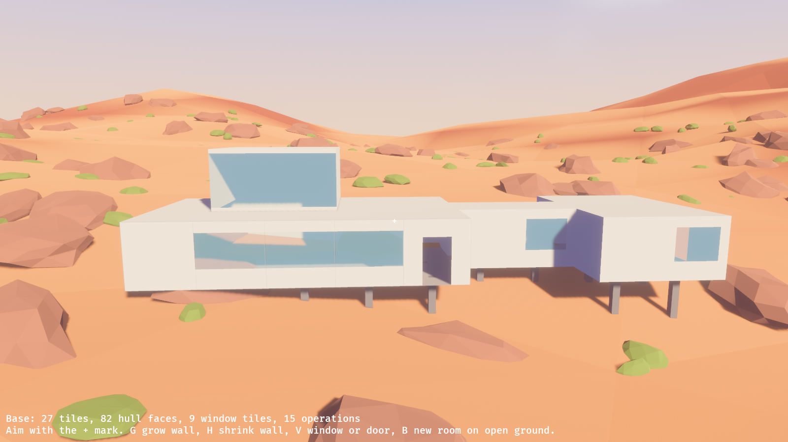

# Subnautica 2's base building, and a first try at it

2026-10-10. Question: how does Subnautica 2's construction system work, which the developers named as their inspiration, and what would the same idea look like here?

## What Subnautica 2 does

From press coverage and community guides. I could not read the developers' own video or a primary description of the controls, so treat the details as second-hand.

- **No fixed modules.** The first game snapped predefined rooms together. The second moves to what its design lead called "a new procedural system, where basically you don't have to be constrained to a specific shape", and "a sculptural base-building system that provides far more flexibility than anything we've done before".
- **A few primitives that can be resized.** Room, corridor, nook, half-round room, moonpool. Guides describe growing and shrinking rooms and corridors along their axes.
- **Windows are shaped, not chosen.** Instead of picking a porthole from a list, you shape a window on a wall. Coverage shows squares, portholes, rounded corners and larger shapes.
- **Interior walls, arches and doors** can be placed inside rooms.
- **The hull has a strength budget.** Each addition changes a structural rating; when it falls too low the base leaks. The exact numbers differ between sources and are unverified.
- **Co-op.** Up to four players can build together.
- **Still changing.** The game is in early access. The developers have said buildings are fairly blocky for now and that round rooms are planned.

## What we tried

A plain crate, `terra_build`, and a sandbox experiment that draws it:

```bash
cargo run -p terra_sandbox -- --experiment look --experiment build
```



The model:

- **A base is the set of tiles inside it.** Each tile remembers which room it was added as. There are no room parts.
- **The hull is generated.** Wherever inside meets outside there is a wall, floor or roof. Rooms that touch open into each other.
- **You resize a room by pushing or pulling one of its walls** by a tile.
- **Windows and doors are a property of a wall tile.** A window is described by its four edges, so it can be any size, and windows on neighbouring tiles with no gap between them read as one long window.
- **Everything is an operation**, so a base can be sent to other players and saved as the list of operations that made it.

It has 13 tests and works through real key presses in the sandbox. One flaw found that way and fixed: at first a wall was "every hull face in the same plane", so pushing one room's wall dragged its neighbour's along. Tiles now belong to rooms.

## The developers' verdict after playing it

2026-10-10, once the experiment had a player and a builder tool (the sandbox's `play` experiment): a good start, but clearly not Subnautica 2's building system yet. What they named as missing:

- **You select the part you want to build.** Ours has no parts to choose from. Its tool has three modes that act on whatever shape is already there.
- **You can cycle through variants of a part.** Ours cycles one thing, a wall tile, through four window sizes and a door.
- **"Similar and other things."** They did not list the rest. The account of the controls above is second-hand, so the list of what is missing should come from them or from playing the game, not from this note.

So the model here, tiles and a generated hull, may survive, but the way a player builds with it has to start from choosing a part.

They then asked for that to be built into the tech demo directly, as "the little dial building menus we see in things like Rust and Subnautica", with the furniture in the example base as buildable items. It now works that way:


- **A dial of fifteen parts**, opened by holding the right mouse button: room, reshape, interior wall, window, door, remove, move, and eight kinds of item.
- **Variants** of the picked part, cycled with R: four room sizes, three windows, twenty-seven items.
- **A preview** of what would be built before committing.
- **Items** stand on a floor or the ground, can be turned, moved and removed, and are solid to walk into.

They then asked for three more things, which are also in:

- **Controls that feel like Subnautica 2's.** See the next section for what could be confirmed.
- **Collision boxes on everything, used for placement too.** An item cannot be put where its box would share space with another item, a wall, a tree or a boulder.
- **A grid things snap to, which can be switched off.** Items land on half-metre steps, turn in eighths, and stand flush against a wall you aim at. Rooms are always on the base's three-metre tiles, so new rooms line up with and join the ones already there.

And, after trying those:

- **Terrain.** A foundation may go into the ground. Anything else that would clip into it shows red and cannot be built. (They said "I think", so this is a leaning.)
- **Rooms across rooms.** A room placed so that it overlaps one already there extends that room to the combined shape, instead of being refused or becoming a second room.
- **Interior walls** as a simple part: a plain wall on the edge between two tiles, indoors only, which the builder enforces. Not interior rooms: just walls. Windows and doors stay separate parts and are cut into an interior wall exactly as into an outside one.
- **The small comforts of good building games.** A grid you can actually see; being told what is in the way, with the item in the way outlined; items that stand flush against, or on top of, the item you aim at; holding Alt to go off the grid for one placement; the middle button to pick another of what you are looking at; and a line of the keys worth knowing.
- **The mouse** was escaping the window. The game now lets go of it properly when its window is no longer in front, and holds the pointer in the middle while it has it.

What all this still is not: parts are text labels with no pictures; nothing costs anything or has to be unlocked; there is no undo; you cannot stand on an item; a second building cannot be started at an angle to the first; and an item is not yet one of the base's operations, so it would not be saved or sent to another player. The list of parts was chosen by what models were to hand, not designed.

## Subnautica 2's controls, and ours

Checked on 2026-10-10 against keybinding lists and guides. They disagree with each other in places and none covers the builder fully, so only what two or more agree on is treated as known.

| | Subnautica 2 | Here |
|---|---|---|
| Open the build menu | Right mouse, with the builder in hand. A tabbed menu: standard elements, interior, exterior, utility, furniture and decor. | Hold right mouse for a dial; let go on a part |
| Place | Left mouse | Left mouse |
| Take apart | Q, then left mouse on the piece | Q, then left mouse on the item or opening |
| Move a piece | F for move mode, then click the piece | F, then left mouse to pick up and again to put down |
| Turn a piece | Not found in any source. The first game used the wheel. | The wheel |
| Variants and resizing | Not found in any source | R for the next variant; the wheel pushes and pulls a wall |
| Snapping | Not found in any source | X switches a grid on and off, which the developers have seen elsewhere |

So the menu, placing, taking apart and moving follow the game. Turning, variants, resizing and the grid are our guesses from the first game and from other building games, and should be corrected by someone who has played it.

## What it does not do

- **How close the building now is to Subnautica 2's is for the developers to judge.** See above.
- **It is boxy.** Flat walls on a square grid, which is the look the developers said they do not want. Rounding, chamfered edges and curved rooms are the obvious next question.
- **Windows are rectangles**, cycled through four presets. No free shaping, portholes or rounded corners.
- **Resizing loses windows.** A window lives on a wall tile, so when the wall moves the window is gone.
- **No interiors**: no inner walls, and no furniture or machines a player can place.
- **No rules**: no cost, power, air, or hull strength.
- **One base, on a formula planet**, standing on a foundation clear of the ground, with no relationship to dug terrain.

Since this note was first written the base has gained trim, lamps, furniture placed by hand, and a player who can walk through it. None of that changes the list above.

## Sources

- [PC Gamer on the developer video](https://www.pcgamer.com/games/survival-crafting/subnautica-2-developer-video-reveals-a-brand-new-base-building-system-with-some-pretty-fabulous-windows/)
- [The Escapist on the modular system](https://www.escapistmagazine.com/news-subnautica-2-modular-base-building-system/)
- [PCGamesN base building guide](https://www.pcgamesn.com/subnautica-2/base-building)
- [Massively Overpowered on the system](https://massivelyop.com/2026/03/15/subnautica-2-shows-off-its-highly-modular-and-customizable-base-building-system/)
- [Subnautica 2 wiki: Window](https://wiki.subnautica.com/sn2/Window)
- [Mobalytics building recipes](https://mobalytics.gg/news/guides/subnautica-2-building-recipes)
- [Shacknews keybindings and controls](https://www.shacknews.com/article/149177/subnautica-2-keybindings-controls)
- [Prima Games complete controls](https://primagames.com/tips/subnautica-2-complete-controls)
- [PC Gamer on the Habitat Builder](https://www.pcgamer.com/games/survival-crafting/subnautica-2-base-habitat-builder/)
- [Subnautica wiki: key bindings of the first game](https://subnautica.fandom.com/wiki/Key_Bindings)
