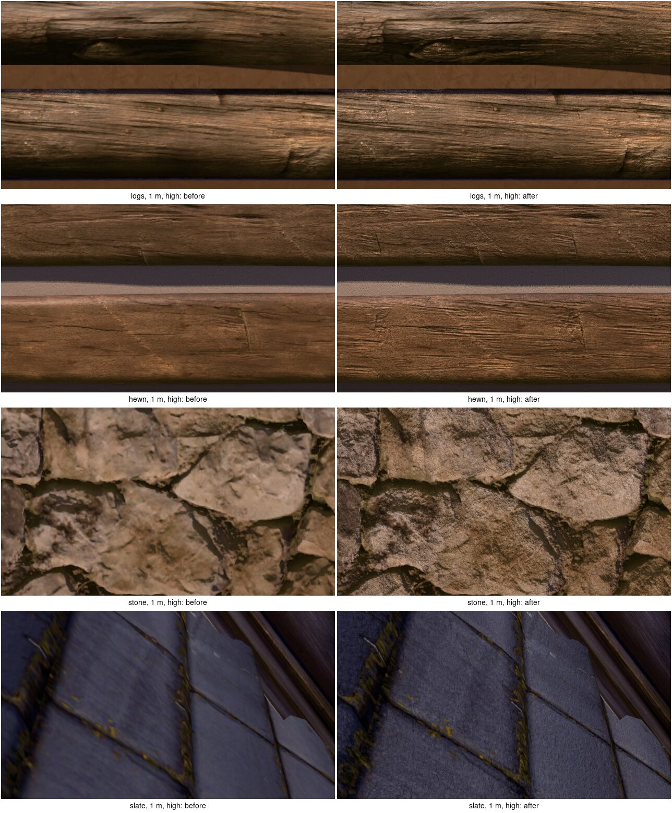

# Texture detail of the construction materials, near

2026-10-15. Why the logs' and the stone's textures read soft a metre or two off, measured against known-good references, and what was done about it (D362).

The developers: "the log textures still look pretty bad. stone might need more improved details too? its important that the detail on our textures is great." The logs had been reworked several times (D262, D290), each time on the look of the bark. This note steps back and measures the whole path from source scan to pixel first.

## How it was measured

- **Stills**: the kit sheet's preview of each material (`--kit-sheet --sheet-rows "<material>: preview"`, D349), a clean stretch of the house's front looked at square on from 1, 2 and 5 m (`--vantage`), noon, offscreen 1920x1080, the Windows build on the real GPU, high and low presets.
- **Screen density**: at 1080p and the game's 55° vertical field of view, a surface square on is 1,037 / d pixels a metre at d metres: 1,037 at 1 m, 519 at 2 m, 207 at 5 m. The industry's target for first-person close-ups is 512 to 1,024 texels a metre.
- **Sharpness**: a picture's *finest octave*, the RMS lost by halving it and doubling it again (box down, triangle up), as a share of its RMS contrast. A sharp scan loses a third or more; an upscaled or blurred picture almost nothing. Measured on the source maps, and on a crop of each still.
- **TAA**: the same frame with Bevy's temporal anti-aliasing taken off the camera live over the remote protocol (`world.remove_components`), then with contrast-adaptive sharpening at 0.4 to 1.0 put on.

## What was found, by how much it cost

1. **The arrays halved every scan.** Every texture set was a 1,024-texel layer (`arrays::SIDE`), and the pack tool cut every map to 1,024 too, so the 2K Poly Haven scans lost three quarters of their texels. A stone wall copy is 2 m: 512 texels a metre, two pixels a texel at 1 m. Slate 427 (2.4 pixels a texel), split shakes 320 by 640 (3.2), the bark 1,090 round and 512 along. Only hewn timber (rough wood at half a metre, 2,048) met the target. Stone at 1 m: finest octave 8.5% of the crop's contrast.
2. **TAA took more than half of what was left.** On a log a metre off, the finest octave is 20.5% of the crop without TAA and 8.7% with it: TAA's blend of jittered frames is a filter about a pixel wide, and nothing sharpened after it at full size (only the low preset's upscaled picture was sharpened). Its mip bias was already -1 (`MipBias`'s default) and its history is read Catmull-Rom; the softening is inherent. Contrast-adaptive sharpening gives back 9.6% at 0.4, 10.7% at 0.6, 15.1% at 1.0.
3. **The log's bark bake.** `pine_log` was baked from the Tripo log at 1,024, a metre round by 2 m along: half the Tripo texture's own 4K density along the log. Its source is soft, a generated texture: its colour keeps 13% in the finest octave against a Poly Haven bark scan's 37%, its normal map 14% against 47%, and its normal's fine relief is a sixth of the scan's (RMS 0.006 against 0.037). The bake stretched it along by 1.25 by taking the *nearest* row, so every fifth row was doubled, a stair in the grain. And its colour kept the light Tripo painted it in: by sixteenths round the log, from 24 to 146 of 255, six times darker underneath than on top, which drew a near-black band under every log on top of the game's own shading.
4. **BC1 colour.** The colour was BC1 from a real-time encoder (the box's corners, inset): four shades a 4x4 block in 5:6:5. On 400 made blocks of two tones and grain, BC7 mode 6 (sixteen shades at 7 bits) has under half BC1's squared error (`bc::tests`). BC7 for colour and BC5 for normals is the standard; normals were already BC5.
5. **Mipmaps** were averaged in sRGB, which darkens each level, and normal maps' levels were not made unit again, which flattens them with distance. Small next to the rest.
6. **The quoins** (D215 as amended today) are cut from the wall's own largest stones, each blown up to a quoin's face: two to three pixels a texel at 1 m before the detail maps, blotchy and soft. The detail maps carry them now; their own size is D215's to judge.

Sampling was not at fault: 16x anisotropic filtering on every array (one sampler, set on the colour array), repeat, and a -1 bias.

## What shipped games do, and what was done

- **Texel density by texture quality**: colour and normal maps 2,048 a side at high and medium, 1,024 at low (`Quality::texture_side`), as a texture quality setting keeps or drops a top mip; occlusion-roughness-metal and height stay 1,024, since they carry no fine detail. A stone wall is now 1,024 texels a metre, a texel a pixel at 1 m.
- **BC7 colour** (mode 6, its line along the block's principal axis then fitted to the steps chosen by least squares, after Rich Geldreich's bc7enc), BC5 normal, BC1 ARM, BC4 height, encoded on a worker as a set is made resident; mipmaps in linear light, normals renormalised.
- **Detail maps**, the standard way to crisp close detail without huge textures (Unity's detail albedo and normal, Unreal's detail texturing): each pattern lays a shared high-frequency texture of its material's grain over its textures near, wood's (from Poly Haven's rough wood) every 40 cm along the grain, stone's (from Poly Haven's rock surface) every 50 cm, faded out from 3 to 8 m, not drawn at the low preset. Data per pattern (`details`), a pack able to name its covering's or take one away.
- **Sharpening after TAA** at every preset, 0.6 at high.
- **The bark rebaked** at 2,048 from the Tripo log's 4K maps, read between rows, its painted light taken out round it (`bake.py`'s `delit`, a fifth of it kept): now 67 to 99 of 255 round the log.

- **Texture sets kept compressed** on disk once made (`arrays::cache`, in the user's cache folder, keyed by the pictures read and how they are stored), as an engine keeps cooked textures: BC7 at 2,048 takes a worker about 0.3 s a set even after it was sped up (one least-squares pass, steps found by projection, a table back to sRGB), on the same workers that lay sections, so the village's sections first reached the screen 4.2 s after starting rather than 2.4 s. Read back, they reach it in under 2 s.
- **Detail strength** by what it reads as at 1 m: wood 0.8; stone 0.6 (0.8 read speckled); slate's covering 0.4, a cleft face smoother than rubble's.

## Results

**Texel density** (texels a metre, the layer's; screen 1,037 px/m at 1 m, 519 at 2 m):

| Surface | Before | After, high | Detail near, high |
|---|---|---|---|
| Stone wall (2 m copy) | 512 | 1,024 | 4,096 |
| Flagstone floor (1.8 m) | 569 | 1,138 | 4,096 |
| Log bark and worn wood (1 m round, 2 m along) | 1,090 x 512 | 2,180 x 1,024 | 5,120 |
| Hewn beam (0.6 m) | 1,707 | 3,413 | 5,120 |
| Slate (2.4 m) | 427 | 853 | 4,096 |
| Shakes (3.2 by 1.6 m) | 320 x 640 | 640 x 1,280 | 5,120 |

The low preset keeps the old density (1,024 layers, no detail): it draws at three fifths of the screen.

**Sharpness**, the finest octave as a share of contrast in the middle of each still, before -> after, at 1, 2 and 5 m:

| | 1 m | 2 m | 5 m |
|---|---|---|---|
| Logs, high | 12.3 -> 21.4 | 14.6 -> 20.2 | 15.4 -> 16.7 |
| Hewn, high | 17.2 -> 32.7 | 14.5 -> 24.7 | 15.7 -> 18.9 |
| Stone, high | 8.9 -> 26.2 | 14.6 -> 28.4 | 18.4 -> 22.1 |
| Slate, high | 7.9 -> 16.8 | 10.8 -> 20.4 | 17.3 -> 22.7 |
| Each at low | unchanged within 0.7 | | |

**Texture memory**: a set 3.3 MiB before; 12 MiB at high, 4 MiB at low after. The village's arrays 139 MiB (18 sets in 32 slots) before; 312 MiB at high (20 sets in 24 slots, growing 8 at a time) and 120 MiB at low after. The pieces' atlases 48 -> 64 MiB (BC7). The budget: 12 MiB a set at high, the arrays under 400 MiB for a village of every baseline material.

**Frame time**, `cargo xtask bench`, 1080p, three runs, a shared machine (median / 99th / worst, ms):

| Scene | Before | After |
|---|---|---|
| village, RTX 5090, high | 4.52 / 5.88 / 9.29 | 4.35 / 6.20 / 10.09 |
| town300, RTX 5090, high | 5.69 / 11.01 / 19.08 | 6.23 / 12.22 / 19.05 |
| village, Radeon integrated, low | 30.43 / 32.38 / 44.54 | 30.36 / 34.86 / 49.28 |

The GPU's own time did not move (village 2.34 -> 2.37 ms; the integrated GPU's opaque pass 15.1 -> 14.6 ms); contrast-adaptive sharpening costs 0.03 ms at high. The village measured steady, 25 s in, alternating builds: before 6.40 and 6.27 ms, after 5.82 and 6.33 ms. Everything holds the 13.3 ms budget; the integrated GPU's median stays under its 33.3 ms.

## Second pass: bark, corner stones, tight courses, variety

As the lead and the developers asked, the same day.

- **Bark.** The Tripo bark rebaked at 2,048 kept a sixth of a scan's fine relief at its own scale, so it was compared on the preview at 1, 2 and 5 m with Poly Haven's `pine_bark` fetched at 4K (through `cargo xtask pack`, which was fetching scans at 1K: now 4K, fitted to 2,048) and laid in patches over bare wood (`textures.ts blend`, its occlusion now from its height, so the kit checker reads its proud bark rightly). The scan in patches was sharper at every distance and read more like real bark (finest octave of its colour 40% against the bake's 11%, its normal 51% against 9%); it replaced the bake, which is gone. The shader's wear to silvered wood on tops, ends and the weather side is unchanged.
- **Corner stones.** Measured by `cargo xtask texels`, now reading the real height maps (with a flat stand-in it saw no stones, so no corner stones): stone's walls 15.2% of their area drawn past 1.5:1 and 10.7% past 2.5:1, all of it quoins and jamb stones blowing one stone up to a face; after, 0.2% and 0.0%. A face now wears the inside of one of the wall's larger stones at the wall's own scale, laid again mirrored beside itself, cut where copies meet; a test holds every face at the wall's scale and every corner of it inside a stone.
- **Tight courses** (the developers: "why do the logs have big gaps between them?"). Logs tapered and thinned to 13 cm against a half course of 12.5 cm and sagged up to 1.5 cm, and the daub stood in front 5 cm tall, so a band up to 6.7 cm showed between courses. Now a wall's log is never thinner where it rests than the kit's log, scribed flat a course apart and a few millimetres into the next, not sagging; the daub set back so a line `joint` tall shows (1.5 cm pine, 1.6 cm hewn, beds flat); a test casts rays at two courses of every shipped coursed material, 16 seeds, both faces, and holds what shows between to 2 cm.
- **Variety** (the developers: "id like them more varied and we want to focus on a degree of realism per our art style"), against photographs of old Norwegian log buildings: each log its own age by its seed, its colour from the kit's warm brown toward grey silver and more of its bark lost where the weather reaches; stains in patches; lichen on its weather face and top; moss up its foot; the upper courses greyed (`masks.weather` 0.5); the daub a little lighter or darker course by course. All in the coursed pattern's data (`timber.variation`, `masks.moss`). It reads, but stays warmer than the photographs, whose wood is mostly grey: the warm tint is the developers' to change.

Frame time with all of it (`cargo xtask bench`, RTX 5090, high, median / p99 ms): village 4.73 / 6.90 (3.17 million triangles, 3.04 before, the corner stones' faces cut where their copies meet), town300 6.09 / 13.03 under the 13.3 budget. Texture memory unchanged: 312 MiB in the arrays for the village's 20 sets.

## What is left

- Log walls still read warmer than real weathered cabins, mostly grey; the timber's warm tint is the developers' to change.
