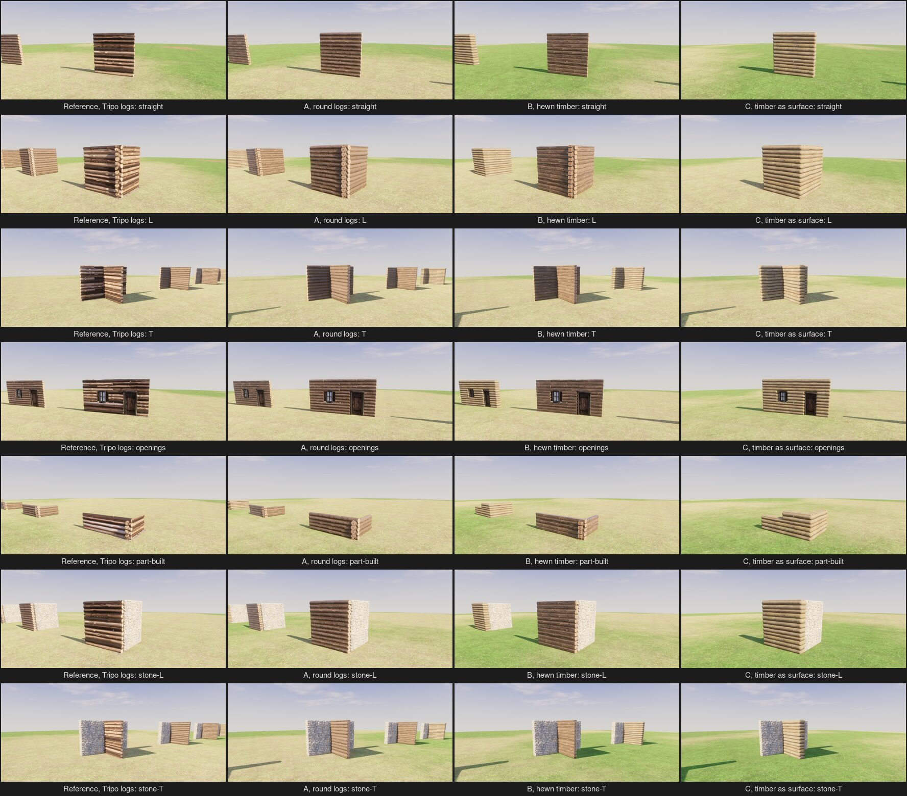
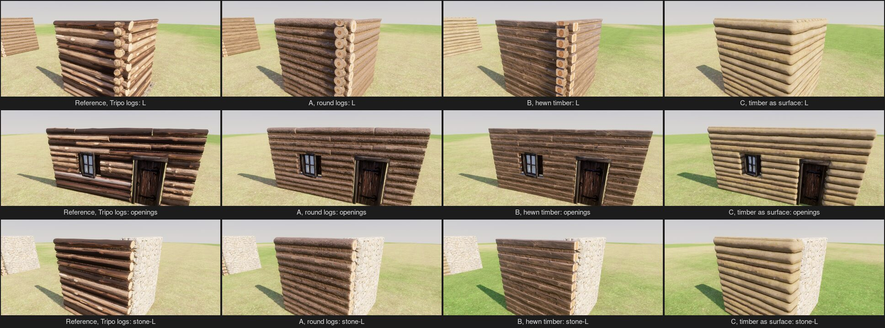
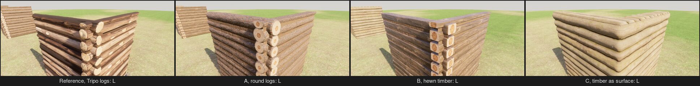

# Timber walls: generated logs, hewn timber, or a timber surface

2026-10-12. Question (the spike [spike/timber-walls](../spike/timber-walls/README.md)): which way of drawing the timber kind procedurally from its cubes looks most beautiful and thematic, compared against today's Tripo logs? The developers: "it doesn't have to be a literal log if we can't make that work but it has to be thematic and look beautiful", and the whole system should be procedural and extend to many materials as data.

## What was built

Seven shapes of half-metre cubes, laid by the game's own layout (`terra_build::logs::lay`) from the same cubes, each drawn four ways side by side and stood on the yard in the game's renderer and light (Windows GPU build, afternoon sun, `--time 15.5`): a straight wall, an L, a T, a wall with a door and a window, a wall 45% built, and timber meeting stone in an L and a T. Doors, windows and stone are the game's own in all four, so only the timber differs.

- **Reference, Tripo logs.** The kit's three Tripo log models (`art/props/kit-log`, two everyday lengths and a long one, 1,500 triangles each), placed, stretched and turned by seed exactly as the game's `build/pieces.rs` does, with the game's daub.
- **A, generated round logs.** Per log: a tube along the layout's run, tapered from one end, bowed, its section a little uneven, 18 sides by a ring every 8 cm; displaced 2 cm by Poly Haven's `pine_bark` height map (CC0) and textured with it; chamfered sawn ends capped with the `log_end` grain, turned by seed; daub in the groove under it. Corners are the layout's: the two walls' courses half a course apart, ends flush at the corner cube's face, so the crossing reads as a saddle-notched corner of stacked ends; no notch is cut, as it is hidden inside the crossing.
- **B, generated hewn timber.** Per log: a squared beam with rounded edges that wander as the axe met the tree's round, faces gently waved and scalloped by the adze, in `rough_wood`; squared ends showing the middle of the `log_end` grain; a little lower than a course, so a band of daub shows between beams. Corners are lapped, the beams crossing alternately.
- **C, timber as surface.** The block kinds' surface (D197, `terra_build::surface`) over the log cubes, as the stone kit draws stone, with Poly Haven's `beam_wall_01` (a wall of weathered peeled logs, CC0) for its colour, normals and height, scaled so one log falls in each 0.25 m course, bevelled 6 cm, displaced 7 cm.

Triangles, Reference / A / B / C: straight wall 18.1k / 18.6k / 22.1k / 19.2k; L 37.8k / 38.8k / 46.1k / 33.2k; T 65.0k / 53.4k / 62.3k / 44.4k; door and window 48.3k / 35.2k / 40.6k / 37.4k (each including the 3k-triangle door and window). Comparable throughout; about 500 a cube.

## What it showed

- **A reads as a log cabin, and the best of the four.** Bark-covered pine logs, each its own shape, with pale sawn ends stacked at every corner and free end: the iconic look, at the same triangles as the Tripo logs. It holds close up: the bark has real relief and a broken silhouette, the end grain is crisp. It meets stone cleanly (logs end flush against it) and goes up log by log. Weak points: the bark is one material's, so every log's bark is the same pine; the end grain is one picture, turned; the daub is a flat strip.
- **B reads as a hewn-timber cabin, nearly as well.** Squared beams with crisp squared ends and a line of daub between, in the Appalachian or Scandinavian way; plainer and more orderly than A, more "built". Its faces are a little dark and board-like from far off, which a warmer face material would fix.
- **The Tripo logs** look richly textured but crude where they meet: dark gaps where stretched models do not sit on one another, light and dark logs side by side because Tripo lit each model differently, and stretched ends. Their look is fixed by three models, so a second species means new models.
- **C is the weakest.** From afar it passes as a log wall, but close up it reads as soft, clay-like rolls: the logs wrap round every corner instead of ending, no end grain shows anywhere, the top course is lumpy, and part-built it steps up a cube at a time rather than a log at a time. The surface is right for blocks because stone has no direction; logs do, and a surface cannot end them.

The ground behind the columns differs (the yard's grass and sand vary by place); it does not touch the walls.

## What it means

Recommendation: **draw timber as generated long members**, A and B being one generator with two profiles: a profile (round, hewn square, half-round, plank) swept along each run the layout gives, shaped by the kit's numbers and the piece's seed, displaced and textured by real materials from the pipeline, with end caps and chinking. Round logs (A) as the default log kit, hewn (B) as a second kit from the same code. Keep C for nothing timber; keep doors, windows and trims as props. This is to timber what D197 is to blocks, and like D197 it is an exception to D177's "every piece is a model": the materials come from the pipeline, the shape from code. It is the developers' call (Open in decisions.md).

**Variants (D182).** A and B make variants by data alone, as a kit file: bark or peeled face material (pine, oak, birch, willow bark; weathered, adzed, charred faces), end grain, chinking (white lime, clay, moss, none), profile, diameter, taper, bend, corner (flush, overhanging, dovetail). With eight face materials, two finishes, three chinkings and three profiles, about 150 kinds of timber wall a player can tell apart (by colour, bark or bare, round or square, light or dark joints), each with every log different. The Tripo way makes one look per set of models, a few a species, each costing credits and a clean-up. C makes one look per log-wall texture, a few dozen at most, and all share its faults.

**To make it real in the game**, the generator moves from the spike into `terra_build` beside `surface.rs` (a log's mesh is pure data), driven by the kit file, run per section on workers as blocks are, with fewer rings and sides further off; the bark height map read once per material, as the surface's is. Further work: a second bark and end-grain picture per material so neighbours differ more, a rounded daub fillet instead of a flat strip, real saddle or dovetail notch geometry where corners overhang.

## Limits

One light (afternoon on the yard), one wood each, judged on stills by an agent; no forest or village around them. Not measured: the cost of generating every log of a large base, or how far the detail can drop at a distance. The Tripo logs were judged as the game places them today, not at their best.
